# ThaOCR: Building a Small, On-Device Document OCR System for Khmer and English

### A technical history of the datasets, models and applications, from the first scene-text recogniser (26 October 2026) to the browser pipeline with layout model v4 (10 November 2026)

| | |
|---|---|
| Project | ThaOCR, Khmer + English document OCR |
| Main code | `~/ocr/docsys/document_system_ocr` (training code in `training/`, server in `backend/`, browser app in `web/`) |
| Earlier code | `~/ocr/scripts` and `~/ocr/dataset*` (first recogniser), `~/ocr/khm_repo_clone/Khm-Dataset-Creation` (recogniser v1, detectors v1) |
| Web app repository | GitHub `chestharastan/ThaFlow-OCR` (static site, deployable on Vercel) |
| Model repository | Hugging Face `Thareah/ThaOCR-models` |
| Run logs | `~/ocr/docsys/work/runs`, `~/ocr/docsys/work/logs`, `~/ocr/khm_repo_clone/det_runs`, `~/ocr/runs` |
| Written | 10 November 2026 |
| Sources | the code, the run scripts, the training logs (`results.csv`, `log.jsonl`, `history.json`), the project status board `work/status.json`, the READMEs, and two validation runs repeated for this book. Appendix D lists the places where earlier summaries (including the published model card) differ from the logs. |

---

## Abstract

ThaOCR turns photographs, scans and PDF files of Cambodian and English documents into editable text that keeps the
document's structure: titles, headings, paragraphs with their first-line indent, lists, tables, letterheads, stamps,
logos, signatures and handwriting. It ends in a reflowed page that can be edited and exported to Word. The whole
pipeline runs on the user's device. Five small neural networks, all exported to ONNX, do the work: a YOLO11n layout
detector (22 region classes, 10.9 MB), a DB text-line detector (PP-OCRv5 mobile backbone, 4.8 MB), a CRNN-CTC line
recogniser for Khmer and English (195 output symbols, 19.1 MB in fp32 or 4.8 MB in int8), a font classifier
(29 families, weight, slant and font size, 1.9 MB) and a small Transformer that predicts reading order, paragraph
starts, list levels and line roles (4.0 MB). The default download is 26 to 41 MB depending on the device tier.

The project grew in four phases over about two weeks of intensive work (26 October to 10 November), on top of an
older server application.
It started from a scene-text line recogniser trained on synthetic Khmer lines (real signboard error 16.4 % against
65.7 % for the public baseline it replaced). It then gained a printed-text dataset built from a cleaned Khmer news
corpus, first-generation layout and line detectors, a synthetic document generator with exact labels, a 21-then-22
class layout taxonomy, real page sets (DocLayNet, D4LA, CommonForms, real Khmer PDFs, signature and stamp scans),
real Khmer handwriting, font and structure models, a server pipeline with many page-analysis rules, and finally a
client-only browser application that downloads the models from Hugging Face and keeps every document in the browser.

The final models reach the following validation results. Layout v4: mAP50-95 0.850 on its own validation set and
0.845 on the older v3 set, where v3 scores 0.848, so the new Khmer official-document data added skill without
forgetting. Text-line detector v2: F1 0.923 on synthetic pages, 0.877 on real Khmer PDF pages and 0.877 on real
DocLayNet pages. Recogniser v2.3: character error rate 0.216 % on synthetic printed Khmer, 0.29 % on real English
lines, 12.7 % on real Khmer signboard crops and 21.5 % on real Khmer handwriting (validation lines); on held-out
test lines, adding 5,860 real handwriting lines cut the handwriting error from 75 % to 26 %. Font classifier v2: 92.3 % family accuracy, 1.8 % median size error. Structure model v1: 98.8 %
role accuracy and 96.4 % reading-order successor accuracy on synthetic pages.

The main lessons are that synthetic data with exact labels carries most of the training, that small amounts of real
data move the hardest metrics the most, that a validation set must not share the new training distribution alone,
and that learned structure models do not yet replace the geometric rules on real pages.

---

## Contents

- [How to read this book](#how-to-read-this-book)
- **Part I. Context**
  - [1. Introduction](#1-introduction)
  - [2. Background](#2-background)
  - [3. History of the project, from the first model to now](#3-history-of-the-project-from-the-first-model-to-now)
- **Part II. Data**
  - [4. Text, normalisation and fonts](#4-text-normalisation-and-fonts)
  - [5. Line-level recognition data](#5-line-level-recognition-data)
  - [6. The synthetic document generator (docgen)](#6-the-synthetic-document-generator-docgen)
  - [7. Real page data](#7-real-page-data)
  - [8. Layout training sets](#8-layout-training-sets)
  - [9. Licences and privacy](#9-licences-and-privacy)
- **Part III. Models**
  - [10. Layout detector](#10-layout-detector)
  - [11. Text-line detector](#11-text-line-detector)
  - [12. Line recogniser](#12-line-recogniser)
  - [13. Font classifier](#13-font-classifier)
  - [14. Structure model](#14-structure-model)
  - [15. Export, size and speed](#15-export-size-and-speed)
- **Part IV. Systems**
  - [16. The server application](#16-the-server-application)
  - [17. ThaOCR web, the client-only application](#17-thaocr-web-the-client-only-application)
- **Part V. Results and discussion**
  - [18. Evaluation summary](#18-evaluation-summary)
  - [19. Lessons learned](#19-lessons-learned)
  - [20. Limitations and future work](#20-limitations-and-future-work)
- **Appendices**
  - [A. Reproducing the work](#appendix-a-reproducing-the-work)
  - [B. Directory map](#appendix-b-directory-map)
  - [C. Model manifest](#appendix-c-model-manifest)
  - [D. Corrections to earlier reports](#appendix-d-corrections-to-earlier-reports)
  - [E. Glossary](#appendix-e-glossary)
  - [F. Change logs](#appendix-f-change-logs)

---

## How to read this book

Readers who want the story should read Chapter 3 first. It walks through every phase and says what changed and why.
Readers who want to reproduce or extend a model should read the matching chapter in Part III together with
Appendix A, which lists the exact commands. Readers who need to judge the numbers should read Chapter 18 and
Appendix D first.

**Conventions.**

- *CER* (character error rate) is the edit distance between the recognised text and the reference divided by the
  length of the reference, in percent. Labels and predictions go through the same Khmer normalisation first. The
  older evaluation suites ignore spaces (`cer_ns`), because Khmer spacing is inconsistent; the training logs count
  them. Each table says which one it uses where it matters.
- *mAP50* is the mean over classes of the average precision at a box overlap (IoU) of 0.5. *mAP50-95* averages the
  same over IoU thresholds 0.50 to 0.95. It rewards tight boxes and is the main layout metric here.
- *F1 at IoU 0.5* for text lines: a predicted line matches a reference line when their boxes overlap with IoU of at
  least 0.5; F1 is the harmonic mean of precision and recall.
- *Validation* numbers come from data held out from training but drawn from the same sources. *Test* numbers come
  from splits used only once at the end. *Real* means real images, not rendered ones.
- Dates are in 2026. Times are local (UTC+7).
- Paths starting with `work/` are relative to `~/ocr/docsys/`. Paths starting with `training/`, `backend/` or `web/`
  are relative to the main repository `~/ocr/docsys/document_system_ocr`.
- Every figure is drawn by `docs/figures/make_figures.py` from the logs, and every value in a figure is also given
  in a table.

---

# Part I. Context

## 1. Introduction

### 1.1 The problem

Most documents that people in Cambodia need to digitise are written in Khmer, often with English mixed in. Official
documents follow a recognisable pattern. A letterhead carries the national emblem and the motto
ព្រះរាជាណាចក្រកម្ពុជា / ជាតិ សាសនា ព្រះមហាក្សត្រ, often above a small ornament. An institution block on the left
holds a reference number that is frequently filled in by hand. Titles are set in Moul display faces. Body
paragraphs start with labels such as យោង ៖ ("reference:"), and lists use dashes and rings. Forms use label and value
rows with counts at the right. Tables may have spanning group rows. Near the end, a red round stamp is pressed over
the signature and often over the printed name, role and date, and a footer carries the address, e-mail and
sometimes a QR code. These pages reach the user as phone photographs, flatbed scans, or PDF files. The PDF text layer
may be clean Unicode, Unicode hidden behind `ActualText` marks, or text typed in a pre-Unicode "legacy" font whose
text layer is Latin gibberish.

A useful OCR system for these documents therefore has to do more than read lines of text. It has to find the
regions of the page and know what each one is. It has to read Khmer and English, printed and handwritten, including
text under a stamp. It has to recover the reading order, the paragraphs, the list levels and the tables. And it has
to hand back something a person can edit, ideally a page that looks like the original when opened in Word.

### 1.2 Goals and constraints

The project's own documents state the goal. The team contract (`~/ocr/docsys/TEAM.md`, 1 November) asks for a
"small, phone-runnable, accurate 3-stage document AI for Cambodian (Khmer) + US/English documents": layout detection,
text-line detection and line recognition, with post-correction left as a hook. The status board extends it to
"layout -> text lines -> recognition -> font -> structure (learned) -> Word-like document; all stages ONNX". Over the
following days the owner added three wishes that shaped the design: output that reflows like a Word document rather
than text placed at photo coordinates, learned models in preference to hand-written rules, and models small enough
to run on a phone or in a browser, with no server at all in the end.

The work ran under real constraints:

- **Hardware.** One laptop with an RTX 3060 Laptop GPU (6 GB) that was also needed for other work. Training jobs ran
  one at a time with a capped share of video memory (`--vram-gb`), paused when the GPU passed 84 °C, and were chained
  by shell scripts so the GPU never sat idle overnight. Sub-agents were limited to the CPU.
- **Disk.** About 7 GB was free when the document work started, so large archives were read in place (for example
  DocLayNet straight from its zip) and raw downloads were deleted after conversion.
- **Licences.** Permissive data (CC0, CC-BY, Apache, MIT, CDLA) was preferred. Non-commercial data could be used for
  evaluation only and is marked as such. Every source is recorded in `training/DATA_SOURCES.md`.
- **Privacy.** Synthetic identities only. The owner's own photographs of handwritten exam sheets were used to study
  the page style and to test the pipeline, never as training data.
- **Honest reporting.** The contract asks every contributor to say what was not verified.

### 1.3 What this work contributes

1. **Data.** Three generations of synthetic line data; a printed-Khmer dataset built in sections from a cleaned news
   corpus; a synthetic document generator (*docgen*) with exact labels for 22 layout classes, text lines, line text,
   handwriting and paragraph structure, in four versions; converters for seven real page datasets into one canonical
   format; and the layout, line-detection and recognition training sets built from all of them.
2. **Models.** Four generations of layout detectors (12, 21, then 22 classes), two fine-tuned text-line detectors,
   a recogniser lineage from v1 to v2.4 with int8 twins, a font classifier with a learned size head, and a structure
   Transformer with a reading-order pointer head.
3. **Systems.** A FastAPI server with a model registry, per-stage model switching and a long list of page-analysis
   rules; two web front ends for it; and ThaOCR web, a static site that runs the full pipeline in the browser with
   ONNX Runtime Web, reads PDFs, and exports Word files.
4. **Evaluation.** Per-stage results on synthetic and real held-out data, kept in the run directories, plus a fair
   re-evaluation of layout v4 against v3 done for this book.
5. **Published artefacts.** The model repository on Hugging Face (31 files at first upload, layout v4 added on
   10 November) and the web application on GitHub.

### 1.4 The final pipeline at a glance

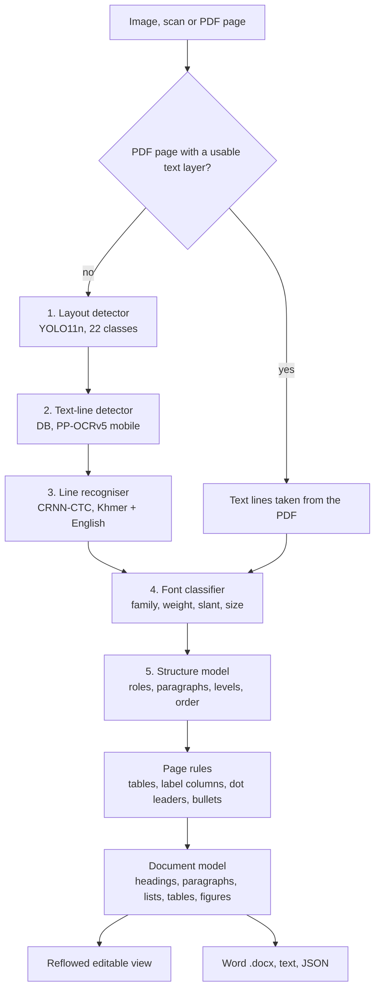

Each stage is a separate ONNX file listed in a manifest (`models.json`), so any stage can be swapped for another
version without code changes. Chapter 15 gives the input and output contract of every model.

### 1.5 Structure of the book

Chapter 2 introduces the script and the methods. Chapter 3 tells the history phase by phase. Part II describes the
data, Part III the models, Part IV the two applications, and Part V the results, the lessons and the open problems.

---

## 2. Background

### 2.1 Khmer script, seen from an OCR system

Khmer is an abugida. Text is a sequence of syllable clusters built around a base consonant. The properties below
are the ones that shaped the data and the models of this project.

- **Stacked consonants.** A second consonant can be written under the first in a subscript form. In Unicode the
  subscript is encoded as the invisible sign COENG (U+17D2) followed by the consonant. A recogniser must therefore
  emit an invisible character to describe a visible stack.
- **Vowels around the consonant.** Dependent vowels can be drawn to the left of, above, below or to the right of the
  base consonant, and some are drawn on two sides at once, but Unicode always stores them after the consonant. The
  visual left-to-right order and the stored order differ, so a recogniser must learn the stored order. Tools that
  sort glyphs by their x position, as some PDF extractors do, destroy it.
- **No spaces between words.** Spaces separate phrases, not words. Invisible zero-width spaces (U+200B) are sometimes
  inserted between words. They are removed from every label because an image cannot show them.
- **Several spellings, one picture.** Some sequences render identically. The project's checks found `្ដ` and `្ត`
  identical in 19 of 27 fonts, and `្រ្ត` and `្ត្រ` identical in all 27. Training on both spellings punishes the
  model for a choice it cannot see, so all labels go through one canonical normalisation (`normalize_khmer`).
- **Digits and punctuation.** Khmer digits (០–៩) and Arabic digits both occur, with Khmer punctuation such as ។ ៖ ៗ.
- **Typefaces.** Body text is usually set in the Khmer OS family (Siemreap, Battambang, Content) or Google's Unicode
  Khmer fonts. Titles use heavy display faces such as Moul and Muol Light. Legacy fonts such as Limon and ABC predate
  Unicode Khmer and store Khmer glyphs under Latin code points, which makes the text layer of such PDFs useless.

The recogniser's character set (`Khm-Dataset-Creation/data/charset.tsv`) has 194 symbols plus the CTC blank:

| Group | Count | Members |
|---|---:|---|
| Khmer consonants | 35 | ក … អ, including the rare ឝ ឞ |
| Khmer independent vowels | 14 | ឥ ឦ ឧ ឩ ឪ ឫ ឬ ឭ ឮ ឯ ឰ ឱ ឲ ឳ |
| Khmer dependent vowels | 16 | ា ិ ី ឹ ឺ ុ ូ ួ ើ ឿ ៀ េ ែ ៃ ោ ៅ |
| Khmer signs and punctuation | 21 | ំ ះ ៈ ៉ ៊ ់ ៌ ៍ ៎ ៏ ័ ៑ ្ (coeng) ។ ៕ ៖ ៗ ៙ ៚ ៛ ៜ |
| Khmer digits | 10 | ០ – ៩ |
| Latin letters | 52 | A–Z, a–z |
| ASCII digits | 10 | 0–9 |
| Space | 1 | |
| Punctuation and symbols | 35 | ASCII punctuation plus « » • ° |
| **Total** | **194** | plus the CTC blank at index 0 = 195 output classes |

### 2.2 The stages of document OCR

A document OCR system answers four questions in order.

1. **Where are the regions, and what are they?** A *layout detector* draws boxes around paragraphs, titles, tables,
   figures, stamps, signatures, logos, handwriting and so on, and labels each box with a class.
2. **Where are the lines of text?** A *text-line detector* finds every line, usually as a rotated quadrilateral, so
   that each line can be cut out and straightened.
3. **What does each line say?** A *line recogniser* reads each cropped line and outputs a character sequence with a
   confidence.
4. **How do the lines fit together?** *Structure analysis* groups lines into paragraphs and lists, decides the role
   of each block (title, heading, header, footer, page number), finds tables and their cells, and orders everything
   for reading.

ThaOCR adds a fifth question that matters for Word output: **how does it look?** A *font classifier* gives each line
its typeface, weight, slant and size.

### 2.3 The model families used

| Stage | Family | Idea in one sentence | Why it was chosen |
|---|---|---|---|
| Layout | YOLO11 (Ultralytics), one-stage anchor-free detector | A convolutional backbone and feature pyramid predict class scores and box distances for every cell of three feature maps; non-maximum suppression removes duplicates. | Fast, small "n" variant (2.6 M parameters), good tooling, easy ONNX export. Licence: AGPL-3.0. |
| Text lines | DB (Differentiable Binarization) with the PaddleOCR PP-OCRv5 mobile backbone | The network predicts a per-pixel text probability map whose high-probability kernels are shrunk text regions; a polygon expansion ("unclip") turns each kernel back into a line box. | Small (1.16 M parameters), handles curved and tilted lines, the original weights are Apache-2.0 and already good on many scripts. |
| Recognition | CRNN with CTC | A CNN turns the line image into a sequence of feature columns, a bidirectional LSTM reads the sequence, and Connectionist Temporal Classification aligns the per-column outputs to the label without character positions. | Small, fast on CPU, accepts any line width, needs only line-level labels, and its CTC output also gives approximate character positions. |
| Font | Small CNN classifier with four heads | Convolution and global pooling over a 32 × 256 line crop; separate heads for family, weight, slant and size. | Under 0.5 M parameters; trained only on rendered text, where every label is known. |
| Structure | Transformer encoder with a pointer head | Each text line becomes a token built from its geometry and a few hashed characters; self-attention lets every line see the page; a pointer head chooses each line's successor in reading order. | Reading order is a relation between lines, which attention models directly; the model stays under 1 M parameters. |

### 2.4 Training ideas used throughout

- **Synthetic data with exact labels.** Rendering text and pages programmatically gives perfect labels for free,
  including tight line boxes, layout classes and paragraph structure. The risk is a gap to real images, which is
  narrowed by heavy degradation (scan, photo, blur, JPEG, perspective) and closed only by some real data.
- **Fine-tuning and replay.** Each new model version starts from the previous best checkpoint. To avoid forgetting,
  the new training set mixes the new data with a sample of the old one ("replay").
- **Time budgets.** Layout runs are given a number of hours rather than epochs (`--hours`, passed to Ultralytics as
  `time`), which is why runs show 17 to 57 epochs.
- **Model choice on held-out data.** The kept checkpoint (`best.pt`) is chosen on validation data, and new versions
  are compared with the old ones on the same sets and on a handful of real pages before they become the default.

---

## 3. History of the project, from the first model to now

This chapter tells the story in order. Every date comes from a commit, a log file or a run directory. The later
chapters describe each dataset and model in depth; here the focus is on what changed at each step and why.

### 3.1 Overview

| Phase | Dates | Where | What it produced | Headline result |
|---|---|---|---|---|
| 0. The original server application | 24 Jun – 4 Sep | `document_system_ocr` (branch `main`) | FastAPI + Next.js app with three PyTorch models: DocLayout-YOLO layout, a YOLO line detector, a ResNet-BiLSTM-CTC recogniser; the v1 HTTP API | a working demo; its API contract is still honoured |
| 1. A scene-text line recogniser | 26 – 27 Oct | `~/ocr` | 747 k synthetic Khmer/English training lines in six sets, CRNN-CTC "S" (2.63 M params), offline demo | real signboard CER 16.4 % against 65.7 % for the public `Thareah/thaocr` baseline |
| 2. Printed text, first detectors | 28 – 29 Oct | `khm_repo_clone/Khm-Dataset-Creation` | news-corpus print sections, recogniser **v1** (CRNN "M", 4.76 M), 5,000 synthetic Khmer pages, text-line detector fine-tune, **layout v1** (YOLO11s, 12 classes, 3 rounds) | print 0.29 % and signboards 14.1 % CER with one model; line F1 on real Khmer PDF pages 0.73 → 0.87 |
| 3. Document OCR v2 | 1 – 9 Nov | `document_system_ocr` (branch `models-v2`) | 21-class taxonomy, docgen v2/exam/v3, DocLayNet and five other real sets, layout v2 (s, n) and **v3**, text-line detector **v2**, recogniser **v2 → v2.4**, font classifier v1/v2, structure model v1, the server pipeline with page-analysis rules, the KhmerOCR app, Word export, Hugging Face release | layout v3 mAP50-95 0.843 at 10.9 MB; real handwriting CER 75 % → 26 % (test lines) |
| 4. ThaOCR web, client only | 9 – 10 Nov | `document_system_ocr/web` → GitHub `ThaFlow-OCR` | browser port of the whole pipeline, PDF text layers, layout rules for tables and labels, docgen **v4**, **layout v4**, model-only switch | v4 0.850 on its set, level with v3 on the old set |

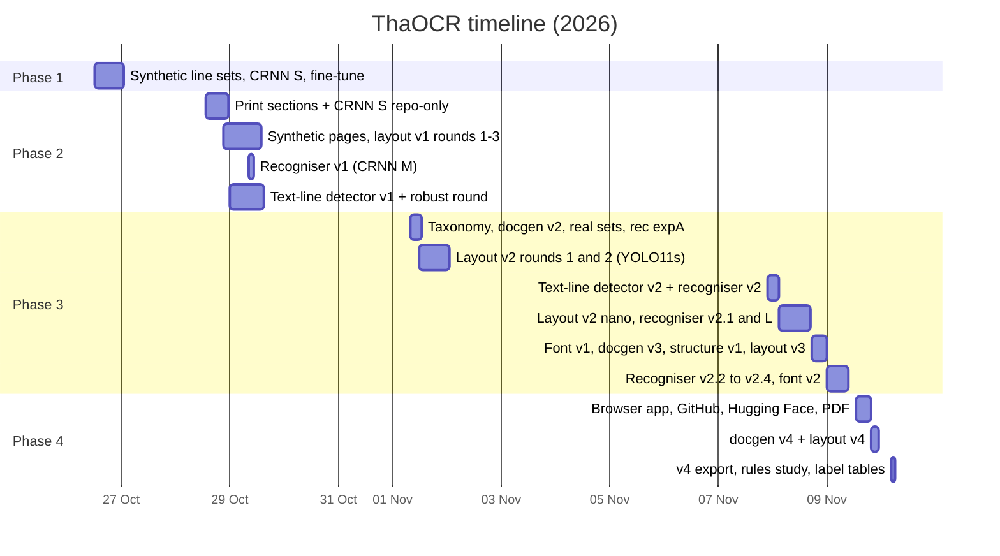

**How the work was organised.** From phase 3 on, the work followed the team contract in `TEAM.md`. A lead (an AI
coding agent acting as ML engineer and reviewer) planned the work, ran every GPU job and reviewed the output of
specialised sub-agents: a data-research lead (ranked open datasets and licences, `work/reviews/data_research.md`),
two synthetic-data engineers (the document generator and the handwritten exam sheets), a data-acquisition engineer
(downloaded and converted six datasets, 1.51 GB), a backend engineer and a QA reviewer (reproduced eight backend
defects as failing tests, `work/reviews/qa_backend.md`). The owner directed the work by stating goals and sending
screenshots of failures. Progress was published on a status board (`work/status.json`) shown by a small monitor web
app on port 8005, which also plots every training run.

### 3.2 Phase 0: the original server application (June – September)

The repository `document_system_ocr` began on 24 June with a FastAPI back end and a Next.js front end. Its models
were PyTorch checkpoints kept outside git in `.model/v1/`:

| Stage | Model | Notes |
|---|---|---|
| Layout | DocLayout-YOLO pre-trained on DocLayNet (`doclayout_yolo_doclaynet_imgsz1120_docsynth_pretrain.pt`) | English-centric document classes, input 1120 px |
| Text lines | a YOLO "line level" detector (`detection/best.pt`) | boxes, confidence 0.25 |
| Recognition | ResNet-BiLSTM-CTC (`recognition/best_model.pth` + `char.json`) | the first Khmer recogniser of the app |

The application already had the shape kept until today: `POST /process` returns pages with blocks and lines,
`/reprocess`, `/regions` and `/lines` let a user correct regions and lines, and `/models` and `/det-models` switch the
recognition and detection models. A README update on 4 September documented the setup. Phase 3 replaced every model
but kept this API (v2 only adds fields and endpoints), and the old model kinds remain loadable as "legacy torch
kinds" in the model registry.

### 3.3 Phase 1: a scene-text line recogniser (26 – 27 October)

The first new model was a line recogniser for Khmer text in photographs. The public baseline, `Thareah/thaocr`
(ThaoNet-Small: a 3-stage lightweight CNN and a 2-layer Transformer-CTC head with d = 128, about 1.6 M parameters,
32 px input, trained on about 90,000 synthetic lines), read real signboard crops at 65.7 % CER and could not output
spaces or Latin letters at all: over 5,000 test lines it emitted 0 of the 4,451 reference spaces and 0 of the 5,675
Latin letters.

**Data.** All training data was rendered. Text came from Khmer Wikipedia (11,994 articles, CC BY-SA 4.0) and 200,000
web and news lines from `Chanrith123333/khmer_english_ocr_image_line` (CC BY 4.0). Lines were cut at cluster
boundaries, normalised (zero-width characters removed, marks reordered, broken clusters dropped), and rendered with
Pillow + Raqm/HarfBuzz in 39 to 57 font files depending on the set, then degraded in three levels plus a "scene"
style (colour, tilt, outlines, tiny crops). Splits were made by source article, so no text appears in two splits.
Section 5.1 lists the six resulting sets (746,697 training lines in total).

**Model and training.** A CRNN-CTC with 2.63 M parameters (`scripts/crnn.py`, later called arch "S"): seven 3 × 3
convolution layers with batch norm and four max-pooling steps reduce a 48 px high line to 3 rows and a quarter of its
width; a linear projection to 256, a 2-layer bidirectional LSTM with 192 units and a linear layer give logits over
193 symbols per time step. An automatic pipeline (`scripts/pipeline_auto.py`) trained it for 16 epochs on
`dataset_v2` (6.3 minutes per epoch), fine-tuned it for 8 epochs on the mixed real-world-style sets (steep tilts,
new fonts, 30–40-word lines), picked the better candidate on held-out real signboard crops, exported it to ONNX
(10.5 MB, 2.7 MB int8) and installed it in an offline web demo that pairs the original PP-OCRv5 mobile detector with
this recogniser.

**Result** (`~/ocr/RESULTS.md`, 27 October 00:28):

| Test set | CER, spaces ignored | Exact lines |
|---|---:|---:|
| Real signboards, held out (5,171 crops, evaluation only) | **16.42 %** | 57.9 % |
| `dataset_v2` test | 3.12 % | 82.7 % |
| `dataset_v2` unseen fonts | 3.00 % | 83.4 % |
| `dataset_long` test (30–40 words) | 5.26 % | 42.8 % |
| Baseline `Thareah/thaocr` on the same real crops | 65.74 % | 9.2 % |
| Baseline `Thareah/khmer_ocr_model_CRNN` | 91.98 % | 1.0 % |

The real crops (`lkhapple/KhmerOCR-Dataset`) have no stated licence, so they were never trained on: a 30 % *dev*
split (2,200 crops, later called `real_dev`) guided decisions and the 70 % *test* split (5,171 crops) was reported.

### 3.4 Phase 2: printed text and the first detectors (28 – 29 October)

The second phase moved to documents. It happened in a copy of a dataset repository, `Khm-Dataset-Creation`, whose
single commit (28 October) is a "Khmer printed-text recognition dataset, built in Kaggle-sized sections".

**Printed text sections.** The repository cleans a scraped Khmer news corpus (5,712 articles → 5,601 kept →
257,501 train / 5,935 validation / 5,482 test lines, split by article) and renders it in independent, deterministic
sections: S01–S08 with 60,000 lines each for training, V01 for validation and T01 for test. Its README lists the
defects of the earlier text data that the new pipeline fixes (duplicates, look-alike spellings, broken clusters,
fonts without Latin glyphs, visual-order PDF text); Chapter 4 repeats that table.

**Recogniser: specialists versus one model.** A 2.63 M-parameter CRNN trained on the print sections alone (8
epochs, 2.3 hours) read printed news lines almost perfectly (0.10 % CER on T01) but failed on photographs (72.9 % on
real signboards). The scene model from phase 1 had the opposite profile (0.80 % on T01, 16.1 % on signboards). A
wider network, arch **"M"** (channels 48-96-192-256, projection 320, BiLSTM 2 × 256, 4.76 M parameters), trained for
6 epochs on a mix of 200,000 print-section lines and all the scene sets with strong GPU-side augmentation, gave the
best of both: 0.29 % on T01 and 14.1 % on real signboards. This is **recogniser v1** (`crnn_m_v1`, 19.1 MB fp32,
4.8 MB int8). The full comparison is in Table 12.4.

**First text-line detector.** The PaddleOCR PP-OCRv5 mobile detector (DB, 1.16 M parameters) was converted from ONNX
to PyTorch and fine-tuned on 5,000 synthetic Khmer pages, real Khmer PDF pages and DocLayNet pages, with targets
that are tight to the ink. F1 at IoU 0.5 rose from 0.650 to 0.935 on synthetic pages, 0.694 to 0.860 on real Khmer
PDF pages and 0.782 to 0.833 on DocLayNet. A low-resolution Khmer scan on which the fine-tuned detector found no line
at all led to a second, "robust" round with simulated low-resolution, JPEG and uneven-light captures and a 1600–2200
px working scale. This **text-line detector v1** (`db_v1.onnx`) was used until phase 3.

**First layout detector.** A YOLO11s detector (9.4 M parameters, 960 px) learned 12 classes (`text, title, list,
table, figure, signature, stamp, logo, qr_barcode, handwriting, header_footer, formula`) in three rounds. Round 1
used synthetic and real pages and scored only 0.18 AP50 on real signature scans. Round 2b added real signature and
stamp scans from SignverOD and mapo80 with pseudo-labels for the other classes and a replay of the Khmer pages
(signatures 0.93, stamps 0.84), but it labelled a dense real Khmer table page as one page-sized figure. Round 3
continued on one union set and fixed that (Khmer tables 0.85 AP50). This is **layout v1** (`layout_v1_12cls`). Since
then every pipeline ignores a `figure` box that covers more than half the page.

**Cascade.** The detectors were combined into layout → page-level line detection → a second line detection on an
enlarged crop of any text region where the page pass found (almost) nothing → recognition. Re-detecting inside every
region was tried first and was worse (0.785 against 0.864 F1 on real Khmer pages), so the second pass only runs where
text was missed. A results dashboard and a test lab served the comparison (ports 8002 and 8003).

### 3.5 Phase 3: document OCR v2 (1 – 9 November)

The third phase rebuilt the document system around five learned stages, in the `models-v2` branch of
`document_system_ocr`. It ran in five bursts.

**3a. Foundations (1 November).** The team contract fixed the rules and the 21-class layout taxonomy
(`training/taxonomy.py`, Section 10.1), designed so that DocLayNet's 11 classes map onto it directly and every
Cambodian document element has a class. On the same day:

- DocLayNet was converted from its zip without extracting it (8,041 pages with 21-class labels and 91 k real English
  text lines from the PDF text layer);
- the synthetic document generator **docgen v2** produced 12,000 training pages of 20 Cambodian and US document types
  with exact labels for all 21 classes;
- the data-acquisition engineer converted D4LA, CommonForms, CORD, the nutrientdocs form benchmark and, for evaluation
  only, FUNSD and KhmerEduDoc;
- the back end was rebuilt as a three-stage ONNX pipeline with a model manifest, and the QA review's eight defects
  were fixed (29 of 29 tests passing at that point);
- recogniser experiment **A** added 90,860 real English lines from DocLayNet (real English CER 3.94 % → 0.88 %);
- **layout round 1** (YOLO11s at 1024 px, from layout v1, 27,805 pages) trained for 6 hours (mAP50-95 0.835) and then
  served as the *teacher* that pseudo-labelled the classes D4LA and CommonForms do not annotate;
- the owner's camera card was imported read-only (46 phone photos of handwritten Khmer exam sheets, 12 held out).
  Layout round 1 missed the handwritten answers on them, which led to a new generator for handwritten exam sheets
  (3,000 pages, 82 k handwritten lines);
- **layout round 2** trained for another 6 hours on 32,290 pages including the exam sheets (handwriting AP50 0.992 on
  the validation set, mAP50-95 0.835).

**3b. Lines and phone size (7 – 8 November).** After recognition crops were cut from the generated pages (99,869
printed lines, 69,081 handwritten exam lines, 11,905 handwritten form values), two GPU jobs ran side by side:
**text-line detector v2** (30,000 iterations on 15,000 synthetic pages, DocLayNet and Khmer PDF pages; held-out
synthetic F1 0.806 → 0.923) and **recogniser v2** (6 epochs on 1.0 M lines per epoch, adding the docgen print and
handwriting lines; synthetic exam handwriting CER 24.2 % → 2.4 %, English real 3.7 % → 0.8 %). A chain script then
started the phone-sized **layout v2 nano** (YOLO11n, 2.6 M parameters, from COCO weights, 4.5 hours, mAP50-95 0.798
against 0.835 for the 3.6 times larger YOLO11s). A new pass for handwriting (the page is detected again at 1600 px
when the layout finds handwriting) raised the lines found on the owner's real exam photos from 5, 5 and 7 to 8, 17
and 21.

**3c. Real handwriting, structure and appearance (8 November).** The recogniser still read real student handwriting
at 75 % CER. Fine-tuning for 3 epochs with two small MIT-licensed real datasets (2,311 Thareah lines oversampled
eight times, 3,549 SoyVitou snippets oversampled four times) cut that to 26 % on the held-out test lines without
hurting print; this is **recogniser v2.1** (`crnn_m_v2_hw`). A wider "L" recogniser (6.8 M parameters) trained from
scratch for comparison was better on handwriting but not on real signboard crops and was not adopted (Section 12.6).
The same day added the page-analysis rules of the server: list bullets found from the ink, tab stops and indent
levels, paragraphs, headers, titles, footers and page numbers by position, ornaments as `decoration`, one font size
per block, red stamps found by colour and faded so the text under them can be read, figures that contain text split
into picture and text. **Font classifier v1** (29 families, weight, slant) trained for 78 minutes. Bold words (first
by stroke erosion, later by the font model) and text colours followed, then the KhmerOCR web app built from the
owner's Figma design, with a Word export that keeps paragraphs, fonts, sizes, colours, bold runs, bullets and
pictures.

**3d. The overnight models (8 – 9 November).** One night produced most of the current defaults:

- **docgen v3** (10,000 pages): every printed line now carries paragraph, role, list level and marker labels; new
  templates (press releases and royal decrees) and letterhead rows with emblem, motto and ornament add the 22nd
  class, `decoration`;
- **structure model v1** (30 epochs in 4.5 minutes): role accuracy 98.8 %, reading-order successor accuracy 96.4 %;
- **layout v3** (YOLO11n fine-tuned 2.5 hours on 10,000 docgen v3 pages plus 8,000 replayed pages): mAP50-95 0.843,
  as good as the 38 MB YOLO11s at a quarter of the size, and the first model that predicts `decoration`. It became the
  default;
- **recogniser v2.2, v2.3, v2.4**: fine-tunes with a stamp-over-text augmentation. v2.2 (25 % of crops, 2 epochs) read
  stamped lines better but misread some printed ones; v2.3 (12 %, 4 epochs) fixed 7 lines and broke 3 on five real
  pages and became the default; v2.4 (4 more epochs) was better on every validation set but 2 lines worse on the real
  pages, so it stayed optional. The notes conclude that further fine-tune rounds only flip the same marginal lines and
  that the next gain needs more real labelled lines.

In the morning **font classifier v2** added a font-size head (median size error 1.7 %), which collapsed three
spurious size levels on one test page into one, and the server began to cut a heading out of a body block whenever
the structure model is at least 95 % sure that some of its lines are headings. The server's output gained a structured `document` (headings, paragraphs with Khmer first-line indents,
lists, footer columns, figures) and a reflowed editable view.

**3e. Publishing (9 November).** The model files and their training notes were collected in
`~/ocr/docsys/hf_thaocr_models/` (all symlinks resolved) and published as `Thareah/ThaOCR-models` on Hugging Face:
31 files, 282.9 MB, with a model card that states the licence of every stage.

### 3.6 Phase 4: ThaOCR web, the client-only application (9 – 10 November)

The last phase removed the server. The whole pipeline, including the page rules, was ported to JavaScript and runs
in the browser with ONNX Runtime Web (WebAssembly on any device, WebGPU where available). Its history is in the web
repository's commits (Appendix F):

1. **First release (9 Nov 16:28).** A static app with the same look as the server app; the models load from Hugging
   Face into the browser's Cache API, documents live in IndexedDB, and nothing leaves the device. The repository was
   published on GitHub (`chestharastan/ThaFlow-OCR`) and its history rewritten into a single commit without large
   files, which shrank the repository from 12.4 MB to about 1.5 MB. The site deploys on Vercel as plain static files.
2. **PDF input (17:23).** Pages with a usable text layer are taken from the PDF without OCR; scanned pages go through
   the pipeline. PDFs written by Skia (Chrome, Google Docs, Android) keep the real Khmer text in `ActualText` marks that
   the PDF library ignores, so the app reads the page content stream itself. Damaged text layers and legacy-font text
   are detected and sent to OCR instead.
3. **Storage reset, reading order and layout fixes (17:28 – 19:36).** A reset that frees everything the site stored;
   dot leaders in tables of contents split into text, tab and page number; row segments joined; tables de-skewed and
   rebuilt from ruling lines with spanning group rows; bullets; one scrollable document per PDF with lazy page
   painting; "Run OCR again"; a responsive review layout; a second-opinion recogniser for doubtful lines; an export of
   corrected lines as training data.
4. **Bold from the font model (20:00).** Line-level and word-level bold from the font classifier, decoration regions
   that give their text back, and stamp text filtered out.
5. **Layout v4 (trained 20:15 – 23:15, default at 04:43 on 10 Nov).** A new generator family (Khmer government notices
   and letters with handwritten reference numbers and dates, label-value rows, bordered tables with group rows,
   stamps over signatures and dates) and a fine-tune of v3. Chapter 10 shows that v4 is much better on such pages and
   level with v3 on the older validation set.
6. **Rules versus models (05:19).** At the owner's request the app gained a "models only" mode that switches off every
   geometric rule. On nine test pages it was clearly worse, so the rules stay on by default and the mode stays
   available. The same commit turns a narrow column of bold or colon-ended labels into a label/value table and
   recovers table rows whose ruling lines the scan lost.
7. **Select page (06:18).** A page for selecting an area of an image and reading only that, added in a separate
   session.

---

# Part II. Data

Most of the effort in this project went into data. Real labelled Khmer document data with a permissive licence does
not exist publicly (the data research of 1 November found none for layout or line boxes), so nearly every label was
produced by rendering, and real data was added where it mattered most. This part describes the text and fonts
(Chapter 4), the line-level data for the recogniser (Chapter 5), the document generator (Chapter 6), the real page
data (Chapter 7), the layout training sets built from them (Chapter 8), and their licences (Chapter 9).

## 4. Text, normalisation and fonts

### 4.1 Text sources

| Source | Size | Used for | Licence or status |
|---|---|---|---|
| Khmer Wikipedia (`wikimedia/wikipedia`, `20231101.km`) | 11,994 articles | phase-1 line sets | CC BY-SA 4.0 (and GFDL) |
| `Chanrith123333/khmer_english_ocr_image_line`, text column | 200,000 web and news lines in 4 shards | phase-1 line sets | CC BY 4.0 |
| Khmer news corpus, scraped by the owner for research | 5,712 articles → 5,601 kept → 257,501 train / 5,935 val / 5,482 test lines, 2,459 distinct clusters | print sections S01–S08, V01, T01; Khmer text in docgen; font classifier | research use; source URLs were not recorded |
| Project Gutenberg, 19 public-domain books | 16 MB raw → 3.4 MB of sentences (25–260 characters, kept as paragraphs) | English text in docgen | public domain in the US |
| Faker `en_US` | names, addresses, companies, phones, dates | US documents in docgen | MIT |
| Random combinations of common Khmer name parts; random digits | names, ID and account numbers | Cambodian documents in docgen | generated, no real person |

The print sections do not use corpus text alone. Inside every synthetic section 65 % of the lines are real news
sentences, 12 % are real words in random order (so the model must read rather than complete frequent phrases), 10 %
are random valid clusters with rare letters boosted, and 13 % are numbers, dates, money, phone numbers, document codes,
list markers, Latin acronyms and punctuation.

### 4.2 Cleaning the text

The `Khm-Dataset-Creation` README documents what was wrong with the earlier text data and how the new pipeline
fixes it. Each defect makes a trained model produce errors even when the architecture is right.

| Problem found | Effect on training | Fix |
|---|---|---|
| 106 duplicate or near-duplicate articles, 1,614 duplicate paragraphs (translator credits ×800, datelines, re-posts), 35,550 duplicate lines | the model memorises phrases and "auto-completes" them | MinHash de-duplication of articles, paragraphs and lines, a cap on repeated phrases, 12 % word-shuffled lines |
| one picture, two spellings (`្ដ`/`្ត` identical in 19 of 27 fonts; `េ`+`ា` against `ោ`; `្រ្ត`/`្ត្រ` identical in 27 of 27; invisible ZWSP/ZWNJ) | the model is punished for a choice it cannot see | `khmerocr/normalize.py` gives every label one canonical spelling; the same normaliser is applied before scoring |
| typos that render as broken clusters (`កំា`, `ា្ត`, doubled vowels) | the image shows a dotted circle or misplaced marks, the label does not | repaired by the normaliser, the rest rejected by a HarfBuzz broken-cluster check |
| fonts without Latin glyphs (Content, Siemreap, Savuth Pen) | Latin text drawn as boxes but labelled as letters | every (line, font) pair is shaped with HarfBuzz first; a missing glyph moves the line to another font |
| Khmer rendered without Raqm | subscripts and vowels in the wrong place | rendering refuses to run without Raqm |
| text cut at a fixed length | lines start with a dangling coeng or vowel | cuts only at word (khmer-nltk) or cluster boundaries |
| an older PDF script sorted characters by x position | Khmer order destroyed (`េក` instead of `កេ`) | PDF text kept in content-stream order (PyMuPDF) |
| scanned PDF pages with hidden OCR text | training on OCR errors | scanned pages and hidden OCR layers skipped |

Phase 1 had applied similar rules to its own text: zero-width characters and the inherent vowels U+17B4/17B5 removed,
curly quotes, dashes and non-breaking spaces mapped to ASCII, combining marks reordered into Unicode order, and lines
with structurally invalid Khmer, characters outside the charset, or less than 50 % Khmer in mixed lines dropped
(about 19 % of 1.3 M candidate lines).

### 4.3 Fonts

| Font group | Files | Licence | Where used |
|---|---|---|---|
| Google Khmer families (Battambang, Content, Hanuman, Kantumruy Pro, Khmer, Noto Sans/Serif Khmer, Nokora, Siemreap, Suwannaphum, Moul, Koulen, …) | 24 families, 39 files in phase 1; 12 print + 9 display + 2 handwriting faces in the print sections | OFL 1.1 | all line data, docgen, font classifier |
| Khmer OS family (Khmer OS, System, Battambang, Content, Siemreap, Muol, Muol Light, Muol Pali, Bokor, Metal Chrieng, Fasthand, Freehand) | system install | LGPL 2.1 | print sections (as extra fonts), docgen, font classifier |
| Khmer UI (Microsoft), Khmer Savuth Pen | 2 | Microsoft EULA; no licence stated | **only** in the phase-1 sets `dataset_nf_mix` and `dataset_nf_hard` ("new fonts" sets); excluded everywhere later (Chapter 9) |
| Latin text fonts (Noto Sans/Serif/Display/Mono/Math, Liberation, Adwaita, TikTok Sans static instances) | serif, sans, mono, condensed, bold, italic, display | OFL 1.1 | docgen |
| Latin handwriting fonts (Caveat, Kalam, Patrick Hand, Indie Flower, Shadows Into Light, Dancing Script, Reenie Beanie, Nothing You Could Do, Gochi Hand, Architects Daughter, Sacramento, Homemade Apple) | 12 | OFL 1.1; Apache-2.0 | docgen handwriting |
| Formula fonts (matplotlib mathtext: DejaVu, STIX, Computer Modern) | built in | free licences | docgen formulas |

Khmer handwriting in the generator comes from the Khmer OS Fasthand and Freehand faces and the handwriting-style
Google faces. They are neater than real student writing, which is why real handwriting lines were added later
(Section 5.4).

---

## 5. Line-level recognition data

### 5.1 Phase-1 synthetic line sets

All images are single grey lines at height 48 px (64 px for the first set) with exact labels; the vocabulary has 193
ids, of which the first 181 match `Thareah/thaocr`.

| Set | Lines | Content | Fonts |
|---|---:|---|---|
| `dataset/` (first version) | 150,000 train + 5,000 val + 5,000 test + 2,480 unseen-font test | Wikipedia lines, 5 % numeric fields, 5 % Latin lines; 25 % clean / 45 % medium / 30 % heavy degradation | 39 files, 20 families in train, 4 held out |
| `dataset_v2/` | 400,000 train + 8,000 val + 8,000 test + 4,000 unseen-font test | document levels plus a "scene" style: colour, tilt, outlines, tiny crops, short labels (median 17 characters). Train levels: scene 187,945, medium 93,686, heavy 62,013, clean 56,356 | 39 files |
| `dataset_hard/` | 65,610 | strong tilt and perspective signs, short strings (mean 10 characters) | 39 files |
| `dataset_nf_mix/` | 80,000 | document and scene mix, new fonts only | Khmer UI, Khmer Digital, Khmer Savuth Pen |
| `dataset_nf_hard/` | 15,087 | steep-tilt scenes, new fonts only | same |
| `dataset_long/` | 36,000 + 1,200 + 1,200 | 30–40 real Khmer words per line (mean 162 characters, 1,670 px wide), document degradations | 57 files |

Degradations include rotation up to 2°, shear, tight to loose crops, light-on-dark text (12 %), low contrast, low
capture resolution (22–44 px, then upscaled), blur, motion blur, paper texture, shading, Gaussian and salt-and-pepper
noise, JPEG, binarisation, bold or thin strokes, and "real-world junk": underlines, table borders at the crop edge and
fragments of neighbouring lines.

### 5.2 Printed-text sections

| Section | Lines | Use |
|---|---:|---|
| S00 | 2,000 | smoke test |
| S01–S08 | 60,000 each | training; recogniser mixes sample 200,000 of the 480,000 |
| V01 | 9,131 | validation: all 5,935 held-out news lines plus generated text; the mixes cap it at 12,000 rows, so all of it is scored |
| T01 | 8,434 | test: all 5,482 held-out news lines plus generated text |
| R1–R4, RX | by PDF | real lines cut from digital Khmer PDFs (education, government, theses, statistics) with strict checks; silver labels because some fonts drop a ligature glyph from the text layer. Defined, but not part of any recogniser mix used here |

Sections are deterministic and independent, so they could be built across several Kaggle sessions. Each one is a
set of parquet files with 10,000 rows (grey PNG bytes, label, font, source).

### 5.3 Lines cut from pages

`training/data/line_crops.py` turns any page manifest with line quads and texts into a packed line set: one binary
file of height-48 grey JPEG crops plus a `metadata.jsonl` with offsets and labels. Labels are normalised, and lines
with a character outside the recogniser vocabulary are skipped and counted.

| Packed set | Train | Val | Test | Source | Real or synthetic |
|---|---:|---:|---:|---|---|
| `rec_doclaynet` | 90,860 | 4,368 | 3,288 | DocLayNet v2 pages, text from the PDF text layer | real English print |
| `rec_docgen` | 99,869 | 3,358 | 3,367 | docgen v2 printed lines (Khmer, English, mixed) | synthetic |
| `rec_exam_hand` | 69,081 | 3,482 | 3,309 | docgen exam answer sheets, handwritten lines, phone-photo degradation | synthetic handwriting |
| `rec_docgen_hand` | 11,905 | 507 | 611 | handwritten form values in docgen v2 (names, numbers, dates) | synthetic handwriting |
| `rec_hand_real_thareah` | 2,311 | 291 | 289 | `Thareah/khmer-handwriting`: 2,891 lines from 147 scanned pages, split by page | **real Khmer handwriting** |
| `rec_hand_real_soyvitou` | 3,549 | 346 | 307 | `SoyVitou/khmer-handwritten-dataset-4.2k`: 4,202 words and short lines | **real Khmer handwriting** |

### 5.4 Evaluation-only line sets

| Set | Size | Content | Why evaluation only |
|---|---:|---|---|
| `real_dev` / `real_test` | 2,200 / 5,171 crops | real signboard and storefront photos (`lkhapple/KhmerOCR-Dataset`), split 30 / 70 by a hash of the file name | no licence stated |
| `real_pdf` | 680 lines | real printed PDF lines cut the way the detector cuts them; references from the PDF text layer are noisy | silver labels |
| T01, `v2_test`, `v2_unseen`, `long_test` | 3,747 scored / 4,000 / 4,000 / 1,200 | synthetic tests of print, scene, unseen fonts and long lines | test splits |

### 5.5 Training mixes

The recogniser trainer reads a JSON "mix": a list of parts (sections, folders or packed sets, each with an optional
sample size) and a list of validation sets. The mix grew with every version:

| Mix | Used by | Parts added | Lines per epoch (after the charset filter) | Validation sets |
|---|---|---|---:|---|
| `mix_print_scene` | v1 | S01–S08 (200 k sampled), `dataset_v2` scene/heavy/medium + 25 k clean, `nf_mix`, `hard`, `nf_hard`, `long` (10 k) | 738,972 | V01, v2, long |
| `exp_a_doclaynet` | expA | + `rec_doclaynet` | 829,802 | V01, v2, en_real |
| `final_v2` | (defined, superseded) | + `rec_docgen` | – | + docgen |
| `final_v2_hand` | v2 | + `rec_docgen`, `rec_exam_hand`, `rec_docgen_hand` | 1,008,452 | + docgen, hand_exam, hand_form |
| `final_v2_hand_real` | v2.1, L, v2.2, v2.3, v2.4 | + Thareah ×8, SoyVitou ×4 | 1,041,136 | + hand_real_thareah, hand_real_soy |

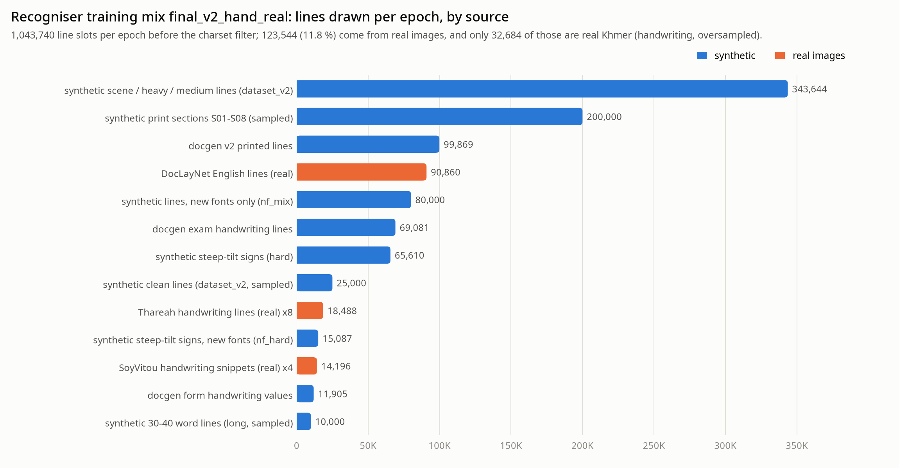

*Figure 5.1. Lines drawn per epoch by source in the final mix, before the charset filter. Real images are 11.8 % of
the slots; real Khmer is only 32,684 slots, all of it handwriting, oversampled from 5,860 distinct lines.*

| Source (final mix) | Lines per epoch | Real? |
|---|---:|---|
| synthetic scene / heavy / medium (`dataset_v2`) | 343,644 | no |
| print sections S01–S08 (sampled) | 200,000 | no |
| docgen v2 printed lines | 99,869 | no |
| DocLayNet English lines | 90,860 | yes |
| new-font lines (`nf_mix`) | 80,000 | no |
| docgen exam handwriting | 69,081 | no |
| steep-tilt signs (`hard`) | 65,610 | no |
| clean lines (`dataset_v2`, sampled) | 25,000 | no |
| Thareah handwriting ×8 | 18,488 | yes |
| steep-tilt signs, new fonts (`nf_hard`) | 15,087 | no |
| SoyVitou handwriting ×4 | 14,196 | yes |
| docgen form handwriting | 11,905 | no |
| 30–40-word lines (sampled) | 10,000 | no |
| **Total** | **1,043,740** | 123,544 real |

---

## 6. The synthetic document generator (docgen)

### 6.1 Principle

docgen (`training/docgen`) draws complete document pages and records, while drawing, everything a model could be
asked to predict: the class and box of every layout element, a tight quadrilateral and the text of every printed
line, the handwritten lines and their text, the formula lines, the font of every line, and from v3 on the paragraph
structure of every printed line. Labels are therefore exact by construction. The generator is CPU-only, runs in
parallel worker processes (about 15 pages per second with 6 workers for v4), and logs zero errors per run.

### 6.2 Modules

| Module | Role |
|---|---|
| `res.py` | loads fonts (with cmap and HarfBuzz checks), the Khmer corpus and the English sentence pool once, before the workers fork |
| `ctx.py` | per-page context: language, fonts, sizes, colours, synthetic names and numbers |
| `canvas.py` | draws shaped text lines into their own coverage masks, measures the ink box of each line, keeps object *point sets* rather than boxes so that boxes can be recomputed after warping |
| `blocks.py` | about 1,000 lines of layout blocks (paragraph, title, list, table, form field, signature block, …), each registering its labels under the taxonomy's rules |
| `templates_km.py`, `templates_en.py`, `templates_exam.py`, `templates_km_v4.py` | document families (Section 6.5) |
| `assets2.py` | procedural assets: signatures and stamps (from the v1 makers plus parameterised stamps), emblems and logos, QR codes and barcodes, charts, maps and diagrams, synthetic portrait silhouettes, formulas |
| `degrade2.py` | capture simulation as one homography plus photometric effects (Section 6.4) |
| `generate.py`, `preview.py`, `stats.py`, `check_fonts.py` | command line, labelled previews, statistics, a glyph check of every line |

### 6.3 Labelling rules

The rules follow DocLayNet where the classes overlap, so that real and synthetic pages agree:

- `text` is a paragraph block, `title` the document title, `section_header` a heading, `list` the whole list block,
  `table` the whole grid (or the text extent of a rule-less table), `caption` a caption block;
- `header` and `footer` are running headers and footers, and also the letterhead, the kingdom-motto block and the
  reference line at the top of official documents; `page_number` is the number alone; `footnote` one box per note;
- `form_field` is a label plus its input region and value ("Name: ______"), including the label/value pairs of ID
  cards and groups of checkboxes; `checkbox` is the box glyph and its tick only;
- `handwriting` is each handwritten value; `signature` and `stamp` are the ink hull; `logo` the emblem (with the word
  mark if it sits beside it); `photo` a synthetic portrait; `qr_code` also covers PDF417-like codes; `barcode` the bars
  only, without the digits;
- `decoration` (from v3) is an ornament, divider or rule drawn between parts of the page;
- watermarks are drawn very lightly and deliberately not labelled.

Because object boxes are computed from warped ink point sets, they stay tight after rotations and perspective.

### 6.4 Capture simulation

`degrade2.apply` turns a clean page into a scan or photo. Every geometric change is a single 3 × 3 homography from
page pixels to output pixels; line quads and object point sets are mapped through it, so labels stay exact.
Photometric effects (stains, folds, fax look, blur, JPEG, noise, lighting gradients, shadows) never move pixels. A
page is degraded with probability 0.6 by default; the modes are `clean`, `scan`, `photo`, `flat` and `rotate`
(docgen v2: 4,873 clean, 2,957 scan, 2,204 photo, 1,102 flat, 864 rotate of 12,000). Exam sheets use a dedicated
profile, `exam_phone`: a close-up 3:4 phone photo with mild perspective, show-through, grey-blue paper, shadows,
defocus, sharpening and JPEG, framed so that no labelled line is cut in half.

### 6.5 Document families

| Family | Templates (current weights) |
|---|---|
| Cambodian (`KM_TEMPLATES`, 13) | `km_gov_notice` 2.6, `km_letter_v4` 2.0, `km_official_letter` 1.4, `km_textbook` 1.3, `km_invoice` 1.2, `km_application_form` 1.1, `km_press_release` 0.8, `km_id_card` 0.8, `km_newspaper` 0.8, `km_certificate` 0.7, `km_royal_decree` 0.6, `km_bank_statement` 0.6, `km_passport` 0.5 |
| US / English (`EN_TEMPLATES`, 11) | `us_invoice` 1.2, `us_letter` 1.1, `us_tax_form` 1.1, `academic_paper` 1.0, `resume` 0.8, `menu_flyer` 0.8, `us_bank_statement` 0.7, `en_textbook` 0.7, `business_card` 0.5, `shipping_label` 0.5, `en_newspaper` 0.5 |
| Exam sheets (2) | `km_exam_sheet` (Khmer national-exam answer sheet: printed candidate form, "ចម្លើយ", ruled handwritten answers with red teacher marks; or a continuation page), `en_exam_worksheet` |

Khmer families mix in English, and some English families mix in Khmer. All content is synthetic and card designs
are generic; no real emblem, logo, form or person is copied.

**The v4 templates** (`templates_km_v4.py`) were modelled on the structure of real university and ministry notices
the owner had problems with: emblem and national-motto letterhead; an institution block with a **handwritten**
reference number; a date line with a handwritten day and month; Moul titles; "យោង ៖" paragraphs; label : value rows
with counts at the right; bordered tables with spanning group rows; a signature block whose red stamp overlaps the
signature and the printed role, name and date; handwritten approval notes; a footer with address, e-mail and QR code.
They add no new class; they cover the confusions seen on real pages better: logo against header text against
decoration, stamp over text, handwriting inside printed lines, and tables with group rows.

### 6.6 Versions

| Version | Date | Pages (train / val / test) | Families | New labels or content | Command (seeds) |
|---|---|---|---|---|---|
| v2 | 1 Nov | 12,000 / 600 / 600 | 20 (9 Cambodian, 11 US) | 21 classes, line quads and texts, handwriting lines, formula lines | `--seed 1 / 101 / 202`, `--lang-mix 0.5` |
| exam | 1 Nov | 3,000 / 150 / 150 | 2 exam families | ruled handwritten answers, `exam_phone` captures | `--lang-mix 0.85`, seeds 101 / 202 / 303 |
| v3 | 8 Nov | 10,000 / 500 / 200 (8,000 + 2,000 extra official pages; 400 + 100) | 24 | `struct` labels per printed line (paragraph, role, level, item, marker, first, indent), press releases, royal decrees, letterhead rows, class 21 `decoration`, footer columns, stamps over dates | seeds 303 / 301 / 302, extras 304 / 305 |
| v4 | 9 Nov | 9,000 / 500 / – | 8 Cambodian | `km_gov_notice`, `km_letter_v4` (Section 6.5) plus 6 existing Cambodian families | seeds 4001 / 4999 |

### 6.7 Statistics

Share of training pages that contain each class (and number of boxes), from `training.docgen.stats`:

| Class | v2 (12,000 pages) | exam (3,000) | v3 (10,000) | v4 (9,000) |
|---|---:|---:|---:|---:|
| text | 94.7 % (74,370) | 69.9 % (2,098) | 94.9 % (58,296) | 99.8 % (62,634) |
| title | 83.0 % (10,544) | 48.3 % (1,449) | 85.0 % (10,142) | 92.4 % (12,253) |
| section_header | 49.4 % (16,995) | 0 | 49.6 % (13,650) | 39.9 % (5,766) |
| list | 26.3 % (7,609) | 0 | 38.5 % (6,989) | 42.8 % (5,677) |
| table | 35.5 % (5,338) | 0 | 25.0 % (3,154) | 27.9 % (2,821) |
| figure | 18.8 % (4,659) | 0 | 14.1 % (2,925) | 5.1 % (550) |
| caption | 21.3 % (5,653) | 0 | 15.9 % (3,503) | 8.4 % (1,067) |
| header | 68.5 % (12,102) | 0 | 72.9 % (11,297) | 93.4 % (14,937) |
| footer | 36.6 % (4,393) | 0 | 43.2 % (5,648) | 63.1 % (7,009) |
| page_number | 37.3 % (4,481) | 0 | 42.7 % (4,268) | 35.5 % (3,197) |
| footnote | 11.2 % (2,417) | 0 | 9.2 % (1,656) | 5.6 % (995) |
| formula | 9.1 % (2,391) | 0 | 7.1 % (1,553) | 4.3 % (654) |
| signature | 41.4 % (5,751) | 23.9 % (962) | 30.8 % (3,591) | 63.2 % (6,299) |
| stamp | 18.3 % (2,410) | 0 | 29.5 % (3,069) | 56.9 % (5,287) |
| logo | 48.8 % (6,138) | 0 | 58.0 % (6,014) | 75.8 % (6,821) |
| qr_code | 18.3 % (2,268) | 0 | 12.4 % (1,295) | 20.1 % (1,809) |
| barcode | 7.5 % (1,239) | 0 | 5.4 % (742) | 2.6 % (237) |
| photo | 13.6 % (1,628) | 0 | 9.2 % (919) | 7.5 % (679) |
| handwriting | 14.3 % (17,907) | 100 % (33,178) | 13.4 % (14,784) | 51.8 % (34,145) |
| checkbox | 15.2 % (12,230) | 0 | 9.7 % (6,900) | 10.9 % (4,166) |
| form_field | 25.3 % (41,986) | 46.3 % (8,553) | 18.4 % (24,477) | 14.2 % (12,487) |
| decoration | – | 0 | 24.6 % (2,846) | 59.8 % (5,729) |

| Property | v2 | exam | v3 | v4 |
|---|---|---|---|---|
| Languages (km / en / mixed) | 3,306 / 5,699 / 2,995 | 2,561 / 439 / 0 | 4,598 / 3,818 / 1,584 | 7,022 / 0 / 1,978 |
| Degraded pages | 7,127 | 3,000 (2,742 `exam_phone`) | 6,164 | 6,289 |
| Printed lines (per page) | 637,801 (53.2) | 12,788 (4.3) | 471,103 (47.1) | 337,688 (37.5) |
| Handwritten lines | 17,907 | 74,679 | 20,580 | 34,155 |
| Long side (min / median / max px) | 993 / 1,611 / 2,200 | 1,400 / 1,524 / 1,816 | 993 / 1,618 / 2,200 | 1,000 / 1,664 / 2,200 |

v4 shifts the distribution on purpose: half of its pages carry handwriting, more than half a stamp, three quarters
a logo and nearly all a header.

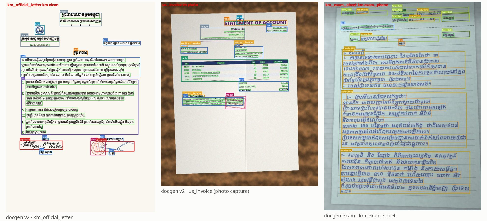

*Figure 6.1. Labelled previews of generated pages: a Khmer official letter and a US invoice captured as a photo
(docgen v2), and a Khmer exam answer sheet (exam). Boxes use the taxonomy colours; thin green quads are printed lines.*

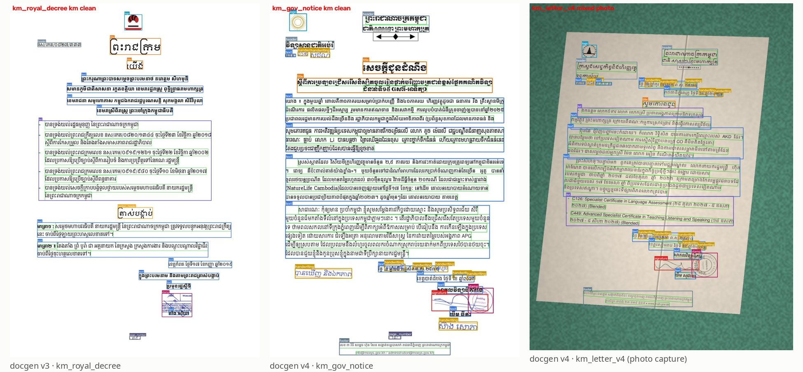

*Figure 6.2. A royal decree (docgen v3), a government notice and a letter captured as a photo (docgen v4). The v4
pages show the handwritten reference number, the handwritten date, the label rows and the stamp over the signature
block.*

### 6.8 Quality control

Every set was checked three ways: `check_fonts` shapes every printed line with its recorded font and reports missing
glyphs and dotted circles; `preview` draws the labels on random pages, which were inspected by eye; and `stats`
reports the class coverage above. The status board notes, for the exam sheets, that they are "still neater than real
student writing".

---

## 7. Real page data

### 7.1 One canonical format

Every real source is converted by `training/data/ext_*.py` (and `doclaynet_v2.py`) into the same page manifest as
docgen: one JSON line per page with the image path, size, source, document type and language, the line quads and,
where real transcriptions exist, their texts, the layout objects with their v2 class ids, flags that say whether
lines and objects are complete (`lines_ok`, `objs_ok`), and, for partially labelled sets, the list of classes that
*are* exhaustively labelled (`partial_classes`). Images are re-encoded as JPEG (quality 88, long side at most 1,600).
Non-commercial sets go to a separate folder (`work/data/eval_nc`) and every record carries `"nc": true`.

### 7.2 The sets

| Set | Pages | Labels used | How it was converted | Role |
|---|---:|---|---|---|
| **DocLayNet v2** (CDLA-Permissive 1.0) | 6,895 train / 647 val / 499 test | 11 classes + `page_number`; tight line quads and texts from the PDF text layer | read straight from the zip; pages rendered from the PDF at long side 1,280; header/footer boxes holding only a number become `page_number`; pictures without text that the annotation omits are recovered from the PDF | layout, line detection, English recognition (`rec_doclaynet`) |
| **Real Khmer PDF pages** | 548 train / 173 val / 131 test (28 of 30 inventory PDFs) | exact lines from the text layer, tightened to the ink; *silver* layout labels from font size, bold, position, PyMuPDF tables and images | `det/pdf_pages.py`; split by document | layout, line detection; each page also used as a degraded copy |
| **SignverOD** (Apache-2.0), **mapo80 stamps** (CC-BY-4.0) | 3,500 pages in the v2 sets (round-3 set of v1); 222 + 400 pages held out in v1 | signature and stamp boxes; other classes pseudo-labelled | `det/prep_real.py`, `det/build_round3.py` | layout (rare classes on real backgrounds) |
| **D4LA** (Apache-2.0 per ModelScope; images are third-party IIT-CDIP scans) | 2,834 train / 711 test pages of 4 types (form, invoice, letter, memo) | 37,066 + 8,459 boxes mapped to text, title, section_header, list, table, form_field, header, footer, page_number, caption, logo | parquet mirror verified identical to the DocLayout-YOLO mirror; "LetterHead" = inside address → text, "RegionList" = mostly borderless tables → table, "Number" (Bates id) → footer | layout, real US scans |
| **CommonForms** (Apache-2.0), one shard | 1,517 pages (1,485 used) | checkboxes only (5,374), as partial labels | input boxes kept as `input_boxes`, signature fields as `sig_fields`, not as classes | layout (checkbox) |
| **CORD v2** (CC-BY-4.0) | 800 / 100 / 100 receipts | 17,777 lines with text, 4,274 form fields | words grouped into lines per semantic field and row | converted; dropped from layout because blurred receipt text cannot be labelled consistently |
| **nutrientdocs form-field benchmark** (CC-BY-4.0) | 214 pages | 1,347 checkboxes, 2,695 input boxes | 5 row groups read over HTTP | checkbox evaluation |
| **FUNSD** (non-commercial) | 50 test pages | 2,649 lines with text, 600 form fields | – | evaluation only |
| **KhmerEduDoc** (CC-BY-NC-4.0) | 60 + 100 pages | page transcriptions only (no boxes) | page text kept for end-to-end page CER | evaluation only |

### 7.3 Pseudo-labelling partial sets

D4LA leaves signatures, stamps, handwriting, checkboxes, most logos and barcodes unlabelled; CommonForms labels only
checkboxes. Training on them as they are would teach the detector that those objects are background.
`training/layout/pseudo_label.py` fills the missing classes with the layout round-1 model as a teacher. Human boxes
are kept exactly; classes listed in `partial_classes` are never added by the teacher; a teacher box is added only if
its class is not human-labelled, its confidence is at least 0.5 (with a separate threshold for small and rare
classes), and it does not overlap a human box. The teacher added 14.9 k boxes to CommonForms and 18 to D4LA.

### 7.4 The owner's documents

Forty-six phone photos of handwritten Khmer exam sheets were imported read-only from the owner's camera card by
`training/data/import_flash.py` (de-duplicated by SHA-1, a fixed 25 % test split). They contain real names and
handwriting. They were used to study the page style that the exam-sheet generator imitates (style only, no text)
and to test the pipeline, and they were never used for training or published. The real test pages that guided the
later work (a Khmer scholarship notice, a stamped ministry statement, a royal decree, press releases, university
notices) were likewise used only for testing.

---

## 8. Layout training sets

### 8.1 Phase 2 (v1, 12 classes)

`det/build_layout_yolo.py` assembled the first YOLO set from 5,000 synthetic Khmer pages (letters, forms, tables,
reports, invoices, certificates, newspapers, posters, ID cards, handwritten notes, with signatures, stamps, logos,
codes, charts and photos), the real Khmer PDF pages and their degraded copies, and DocLayNet-base pages (2,991 /
299 / 300), and pasted signatures, stamps, QR codes and logos onto real pages so that rare classes were also seen on
real backgrounds. Round 2 added the real signature and stamp scans with pseudo-labels; round 3 merged everything into
one union set (`det_data/round3`).

### 8.2 Phase 3 (v2, 21 classes)

`training/layout/build_yolo.py` assembled two sets from canonical manifests:

| Source | `layout_v2_r1` train | `layout_v2_r2` train |
|---|---:|---:|
| docgen v2 pages | 12,000 | 12,000 |
| DocLayNet pages | 6,875 | 6,875 |
| DocLayNet, degraded copies | 1,500 | 1,500 |
| real signature and stamp scans (v1 round 3) | 3,500 | 3,500 |
| D4LA (pseudo-labelled) | 2,834 | 2,834 |
| real Khmer PDF pages + degraded copies | 548 + 548 | 548 + 548 |
| CommonForms (pseudo-labelled) | – | 1,485 |
| docgen exam answer sheets | – | 3,000 |
| **Total train / val** | **27,805 / 773** | **32,290 / 923** |

Validation: 300 DocLayNet, 300 docgen v2 and 173 Khmer PDF pages (+ 150 exam sheets in round 2).

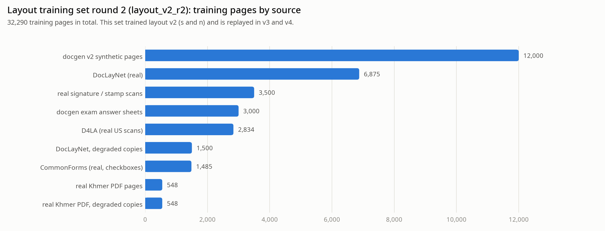

*Figure 8.1. Training pages of `layout_v2_r2` by source.*

Box counts of `layout_v2_r2` (train): text 172,000; form_field 56,219; handwriting 51,291; section_header 38,248;
list 33,484; header 18,297; checkbox 17,604; figure 16,995; title 15,421; table 12,936; footer 12,338; page_number
10,995; signature 9,814; caption 8,202; logo 7,028; stamp 6,204; formula 4,850; footnote 3,039; qr_code 2,387; photo
1,628; barcode 1,297.

### 8.3 Fine-tune sets with replay (v3 and v4)

`training/layout/build_finetune.py` hard-links new docgen pages and a random sample of an older YOLO set into a new
one. **`layout_v3`** = 10,000 docgen v3 pages + 8,000 pages sampled from `layout_v2_r2`, and 500 + 600 for
validation: 18,000 / 1,100, exactly as planned.

**`layout_v4`** was built with
`build_finetune --docgen docgen_v4 --base layout_v3 --base-train 10000 --base-val 700 --seed 4`. The script reported
19,000 / 1,200 pages, and that number was repeated in the first descriptions of v4. While writing this book the
folder was counted again: it holds **14,027 training and 887 validation pages**. The cause is a naming collision. The
script names docgen pages with a fixed prefix, `dg3_`, whatever the docgen version, so the v4 pages (`dg3_dg_0000000`
to `dg3_dg_0008999`) received the same file names as the v3 pages already inside the base set. The link helper skips a
file that exists, so every replayed v3 page whose name was taken by a v4 page was silently dropped while still being
counted. Image and label always came from the same page, so no label is wrong; only the replay share is smaller than
intended.

| Source in `layout_v4` | Train | Val |
|---|---:|---|
| docgen v4 pages | 9,000 | 500 |
| docgen v3 pages (indices 9,000–9,999, no collision) | 549 | 0 |
| docgen v2 pages | 1,664 | 124 |
| DocLayNet pages | 1,126 | 132 |
| docgen exam sheets | 443 | 68 |
| D4LA | 411 | 0 |
| stamp scans | 285 | 0 |
| CommonForms | 226 | 0 |
| signature scans | 199 | 0 |
| real Khmer PDF pages | 124 | 63 |
| **Total** | **14,027** | **887** |

Two consequences follow. The v4 model saw 5,027 replayed pages instead of 10,000, yet Section 10.6 shows that it did
not forget the older distribution. And 500 of the 887 validation pages are new-style docgen v4 pages, so the v4
validation score favours v4; Chapter 10 therefore also scores both models on the untouched v3 validation set. The
fix is one line (derive the prefix from the docgen folder name) and is listed in Chapter 20.

---

## 9. Licences and privacy

| Item | Licence or status | Consequence |
|---|---|---|
| Layout models (all versions) | fine-tuned from Ultralytics YOLO11 weights: **AGPL-3.0** | shipping them in a closed product or serving them over a network requires AGPL compliance or a commercial licence; the YOLO-format data can train any other detector |
| Text-line detectors | derived from PaddleOCR PP-OCRv5 mobile: Apache-2.0 | free to redistribute |
| Recogniser, font and structure models | trained from scratch by the project | owner's own models |
| DocLayNet | CDLA-Permissive 1.0 | training allowed |
| D4LA | Apache-2.0 per ModelScope; page images are third-party IIT-CDIP documents | training used; content copyright belongs to third parties |
| CommonForms, CORD, nutrientdocs | Apache-2.0, CC-BY-4.0, CC-BY-4.0 | training or evaluation allowed with attribution |
| SignverOD, mapo80 stamps | Apache-2.0, CC-BY-4.0 | training allowed |
| Thareah and SoyVitou handwriting | MIT | training allowed |
| FUNSD, KhmerEduDoc | non-commercial | **evaluation only**; no model was trained on them |
| `lkhapple/KhmerOCR-Dataset` real signboards | no licence stated | **evaluation only** |
| Khmer news corpus | scraped for research; source URLs not recorded | research use; the rendered sections should not be redistributed without checking |
| Real Khmer PDF pages | public Cambodian sources with varying licences | local training and evaluation only; rendered pages not redistributed |
| Khmer Wikipedia text | CC BY-SA 4.0 | the phase-1 line dataset is CC BY-SA 4.0 |
| Khmer UI (Microsoft EULA), Khmer Savuth Pen (no licence) | restrictive or unknown | used to render the phase-1 `nf_mix` and `nf_hard` sets, which are still part of every recogniser mix; whether training on such renders is permitted was not verified, and these images must not be redistributed |
| 34 scene pictures in docgen | taken from the v1 Khmer PDF crawl, hand-picked to contain no people, logos or documents | licence of each picture not verified: research use |
| Owner's exam photos | private (real names and handwriting) | never trained on, never committed, never published |

---

# Part III. Models

## 10. Layout detector

### 10.1 Task and taxonomy

The layout detector draws a box around every region of a page and gives it one of 22 classes. The class list lives
in one file, `training/taxonomy.py`, shared by the dataset builders, the trainers, the exports and the server; ids
are never reordered, only appended. Twelve classes carry text that the recogniser reads; the other ten are kept as
image crops.

| Id | Class | Meaning | Read as text? |
|---:|---|---|---|
| 0 | text | body paragraph or text block | yes |
| 1 | title | document title | yes |
| 2 | section_header | section or sub-section heading | yes |
| 3 | list | bulleted or numbered list (whole list; one item in DocLayNet) | yes |
| 4 | table | table, whole grid including the header row | yes (lines inside) |
| 5 | figure | picture, chart, diagram, map, illustration | crop |
| 6 | caption | figure or table caption | yes |
| 7 | header | running header, letterhead text, reference line at the top | yes |
| 8 | footer | running footer | yes |
| 9 | page_number | standalone page number | yes |
| 10 | footnote | footnote or endnote | yes |
| 11 | formula | mathematical formula | crop |
| 12 | signature | handwritten signature or initials | crop |
| 13 | stamp | seal or official ink stamp | crop |
| 14 | logo | logo, emblem, coat of arms | crop |
| 15 | qr_code | QR or other 2-D code | crop |
| 16 | barcode | 1-D barcode | crop |
| 17 | photo | portrait or ID photo of a person | crop |
| 18 | handwriting | handwritten text: filled form values, notes, dates | yes (since v2) |
| 19 | checkbox | checkbox or radio button, ticked or empty | crop |
| 20 | form_field | fill-in field: label plus its input box, line or value | yes |
| 21 | decoration | ornament, divider or rule between parts of the page (added in v3) | crop |

The v1 detector used 12 classes. Its `header_footer` maps to `header` or `footer` by position and its `qr_barcode`
to `qr_code` or `barcode` by aspect ratio, so v1 can still be loaded by the v2 server.

### 10.2 Architecture

All layout models are Ultralytics **YOLO11** detectors. The backbone stacks strided convolutions and C3k2 blocks
(cross-stage partial blocks with small bottlenecks) and ends with a fast spatial-pyramid pooling block (SPPF) and a
C2PSA block (position-sensitive self-attention). A path-aggregation neck fuses three scales, and a decoupled,
anchor-free head predicts, for every cell of the stride-8, stride-16 and stride-32 feature maps, 22 class scores and
the distances from the cell to the four box sides. The side distances are predicted as small distributions and
trained with distribution focal loss. At the 1024 × 1024 input the three maps have 128², 64² and 32² cells, so the
exported network returns 21,504 candidates as one tensor `[1, 26, 21504]` (box centre x and y, width, height and 22
class scores). Non-maximum suppression runs outside the network.

| Model | Scale | Parameters | ONNX size | Classes |
|---|---|---:|---:|---:|
| layout v1 | YOLO11s | 9,432,436 | 38.2 MB | 12 |
| layout v2 round 2 | YOLO11s | 9,435,919 | 38.2 MB | 21 |
| layout v2 nano | YOLO11n | 2,609,743 | 10.9 MB | 21 |
| layout v3, v4 | YOLO11n | 2,609,986 | 10.9 MB | 22 |

Training minimises a weighted sum of a box loss (CIoU, weight 7.5), a classification loss (binary cross-entropy,
0.5) and the distribution focal loss (1.5).

### 10.3 Training recipe

`training/layout/train.py` wraps the Ultralytics trainer. Every run used the same recipe, chosen in phase 2 and kept:

| Setting | Value | Reason |
|---|---|---|
| Image size | 1024 (v1: 960) | small Khmer subscripts and marks need resolution |
| Optimiser | AdamW, weight decay 5e-4, cosine learning rate to 1 % of `lr0`, 1 warm-up epoch | stable fine-tuning |
| Initial learning rate | 2e-3 from COCO weights; 1e-3, 6e-4, 5e-4, 3e-4 for successive fine-tunes | lower for each continuation |
| Mosaic | 0.6, switched off for the last 3 epochs | more objects per image, then real page statistics at the end |
| Geometric augmentation | rotation ±2°, scale ±35 %, translation 8 %, shear 1°, perspective 0.0003 | pages are nearly upright |
| Flips | none | mirrored text is not text, and page layouts are not symmetric |
| Colour | hue 0.015, saturation 0.5, value 0.35 | paper tint, lighting, red stamps |
| Mixed precision | on | speed on the 6 GB GPU |
| Budget | `--hours`, passed to Ultralytics as `time`; the learning-rate schedule is fitted to the time budget, which overrides the epoch count | runs fit into nights and chains |
| Memory | `--vram-gb` caps the process's share of GPU memory | the GPU was shared |

### 10.4 All training runs

| Run | Model | Initialised from | Data | Batch | lr0 | Budget | Epochs | Best epoch | P | R | mAP50 | mAP50-95 |
|---|---|---|---|---:|---:|---|---:|---:|---:|---:|---:|---:|
| v1 round 1 | 11s, 960 | COCO `yolo11s.pt` | v1 synthetic + real | 8 | 1e-3 | 1.4 h | 17 | 17 | 0.876 | 0.857 | 0.903 | 0.757 |
| v1 round 2 | 11s, 960 | v1 round 1 | + real signature and stamp scans, thin Khmer replay | 8 | 3e-4 | 6 ep | 6 | 6 | 0.857 | 0.862 | 0.902 | 0.744 |
| v1 round 2b | 11s, 960 | v1 round 1 | as round 2, all Khmer pages replayed | 8 | 3e-4 | 6 ep | 6 | 5 | 0.901 | 0.832 | 0.898 | 0.744 |
| v1 round 3 (**layout v1**) | 11s, 960 | round 2b | union set | 8 | 5e-4 | 1.3 h | 12 | 12 | 0.891 | 0.851 | 0.907 | 0.765 |
| v2 round 1 | 11s, 1024 | layout v1 | `layout_v2_r1` | 8 | 1e-3 | 6 h | 26 | 23 | 0.950 | 0.931 | 0.964 | 0.835 |
| v2 round 2 (`layout_v2_r2_21cls`) | 11s, 1024 | v2 round 1 | `layout_v2_r2` | 8 | 5e-4 | 6 h | 22 | 19 | 0.947 | 0.930 | 0.963 | 0.835 |
| v2 nano (`layout_v2_n_21cls`) | 11n, 1024 | COCO `yolo11n.pt` | `layout_v2_r2` | 16 | 2e-3 | 4.5 h | 31 | 30 | 0.941 | 0.910 | 0.956 | 0.798 |
| **v3** (`layout_v3_n_22cls`) | 11n, 1024 | v2 nano | `layout_v3` | 16 | 6e-4 | 2.5 h | 37 | 33 | 0.958 | 0.946 | 0.973 | 0.843 |
| **v4** (`layout_v4_n_22cls`, default) | 11n, 1024 | v3 | `layout_v4` | 16 | 3e-4 | 3 h | 57 | 40 | 0.960 | 0.956 | 0.974 | 0.847 |

Precision, recall and mAP are the training-time validation values of the kept epoch, each on the run's own
validation set. Numbers in different rows therefore measure different sets; Section 10.6 compares models on shared
sets.

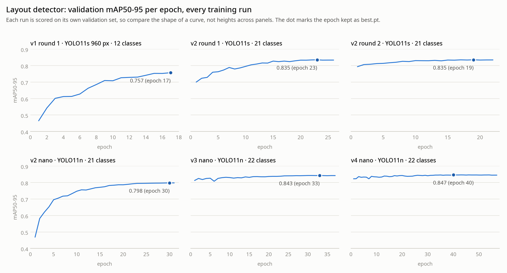

*Figure 10.1. Validation mAP50-95 per epoch for six runs. Fine-tunes (v2 round 2, v3, v4) start high and gain slowly;
runs from COCO weights (v1 round 1, v2 nano) climb for 15–30 epochs.*

### 10.5 Small or nano?

Layout v2 nano lost 3.7 mAP50-95 points against the YOLO11s model on the same validation set (0.798 against 0.835).
After the v3 fine-tune the gap closed. On the 1,100-page v3 validation set:

| Model | Size | CPU time per page (4 threads) | mAP50 | mAP50-95 | Predicts `decoration` |
|---|---:|---:|---:|---:|---|
| YOLO11s round 2 | 38.2 MB | 179 ms | 0.971 | 0.847 | no |
| YOLO11n v3 | 10.9 MB | about 70 ms (v2 nano: 70.5 ms) | 0.973 | 0.843 | yes |

On the real test pages the two were equivalent once the pipeline rules were applied, and only v3 found the ornaments
under emblems. The nano model became the default because it is a quarter of the size and more than twice as fast,
which matters for phones and browsers.

### 10.6 Layout v4 against v3

Layout v4 was trained to fix what users saw on real Khmer notices: logos taken for header text, stamps over text,
handwritten reference numbers and dates inside printed lines, and tables with group rows. Because 500 of the 887 v4
validation pages are new-style docgen v4 pages (Section 8.3), a fair comparison needs a second set. For this book both
models were scored again with the same script on both sets:

| Validation set | Pages | v3 mAP50 | v3 mAP50-95 | v4 mAP50 | v4 mAP50-95 |
|---|---:|---:|---:|---:|---:|
| v4 validation set (500 docgen v4 + 387 replayed) | 887 | 0.935 | 0.802 | **0.974** | **0.850** |
| v3 validation set (500 docgen v3 + 600 replayed) | 1,100 | **0.973** | **0.848** | 0.970 | 0.845 |

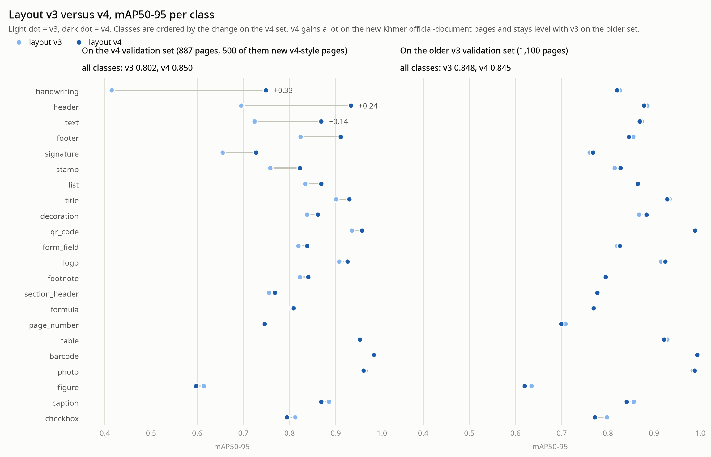

*Figure 10.2. mAP50-95 per class for v3 (light) and v4 (dark) on both validation sets.*

| Class | v3 on v4 set | v4 on v4 set | change | v3 on v3 set | v4 on v3 set | change |
|---|---:|---:|---:|---:|---:|---:|
| handwriting | 0.415 | 0.749 | +0.334 | 0.826 | 0.820 | −0.006 |
| header | 0.695 | 0.932 | +0.238 | 0.885 | 0.878 | −0.007 |
| text | 0.724 | 0.868 | +0.145 | 0.873 | 0.869 | −0.004 |
| footer | 0.823 | 0.911 | +0.087 | 0.855 | 0.845 | −0.009 |
| signature | 0.655 | 0.727 | +0.072 | 0.760 | 0.768 | +0.007 |
| stamp | 0.758 | 0.822 | +0.064 | 0.814 | 0.827 | +0.013 |
| list | 0.833 | 0.868 | +0.035 | 0.866 | 0.864 | −0.001 |
| title | 0.901 | 0.929 | +0.028 | 0.933 | 0.928 | −0.005 |
| decoration | 0.837 | 0.861 | +0.023 | 0.868 | 0.883 | +0.016 |
| qr_code | 0.935 | 0.956 | +0.022 | 0.988 | 0.989 | +0.001 |
| form_field | 0.819 | 0.837 | +0.019 | 0.820 | 0.826 | +0.006 |
| logo | 0.907 | 0.925 | +0.018 | 0.915 | 0.924 | +0.010 |
| footnote | 0.822 | 0.840 | +0.018 | 0.796 | 0.795 | 0.000 |
| section_header | 0.755 | 0.768 | +0.012 | 0.779 | 0.777 | −0.003 |
| formula | 0.805 | 0.808 | +0.004 | 0.770 | 0.769 | −0.001 |
| page_number | 0.745 | 0.746 | +0.001 | 0.708 | 0.699 | −0.009 |
| table | 0.951 | 0.952 | +0.001 | 0.928 | 0.922 | −0.006 |
| barcode | 0.982 | 0.982 | 0.000 | 0.994 | 0.993 | −0.001 |
| photo | 0.964 | 0.960 | −0.004 | 0.983 | 0.987 | +0.005 |
| figure | 0.614 | 0.597 | −0.017 | 0.634 | 0.620 | −0.014 |
| caption | 0.885 | 0.868 | −0.017 | 0.856 | 0.841 | −0.015 |
| checkbox | 0.812 | 0.794 | −0.018 | 0.798 | 0.771 | −0.027 |

**Reading the result.** On pages like the ones it was built for, v4 is far better: handwriting inside official
letters (+0.33), header text versus logo (+0.24), body text (+0.14), and stamps and signatures (+0.06 to +0.07). On the
older set it is level with v3 (−0.002 overall): small gains on stamp, signature, logo and decoration, small losses on
checkbox, caption and figure, classes that v4's data contains less often. v4 is a specialisation for Khmer official
documents that did not cost general skill, which is why it became the default. It is not a general jump in accuracy,
and part of its gain on the v4 set is the advantage of being validated on its own training distribution.

These standalone validations give slightly different numbers from the training-time validation in Section 10.4
(for example 0.848 against 0.843 for v3 on its own set) because the validation settings differ; only numbers from
the same table should be compared.

### 10.7 What v1 achieved on real data

Layout v1 was the only version scored on real held-out scans per class (AP50, `det/eval_layout.py`):

| Held-out set | Round 1 | Round 2b | Round 3 (v1) |
|---|---:|---:|---:|
| synthetic pages (mean) | 0.970 | 0.967 | 0.969 |
| real signature scans (SignverOD, 200 pages) | 0.18 | 0.93 | **0.94** |
| real stamp scans (200 pages) | 0.60 | 0.84 | **0.87** |
| real DocLayNet pages (mean of 7 classes) | 0.756 | 0.728 | 0.754 |
| real Khmer PDF pages (mean, silver labels) | 0.363 | 0.346 | 0.362 |
| … of which Khmer text blocks / tables | 0.72 / 0.61 | 0.64 / 0.72 | 0.66 / **0.85** |

The signature and stamp scans are held out by image, and scans from the same templates can appear on both sides, so
the numbers mean "real scans of that kind". The Khmer layout labels are heuristic, so titles, lists and headers score
low partly because the labels are noisy; text blocks and tables are the meaningful rows.

### 10.8 Can the layout model be made smaller?

The v4 network was quantised two ways and tested on five test pages in the browser pipeline:

| Variant | Size | Result |
|---|---:|---|
| fp32 (default) | 10.9 MB | reference |
| int8, dynamic (ONNX Runtime `quantize_dynamic`, weights only) | 3.3 MB | same regions on most pages, but looser boxes on tables and forms; a title merged into the paragraph below it on the stamped ministry letter. Listed in the app as an option, not the default |
| int8, static QDQ (48 calibration pages, MinMax, per-channel) | 3.3 MB | unusable: logos, stamps, decorations and tables disappeared, pages became plain text blocks. Discarded |

A smaller default needs quantisation-aware training or a calibration that keeps the detection head in higher
precision; Chapter 20 lists it.

### 10.9 Inference

The page is letterboxed into 1024 × 1024 (aspect ratio kept, grey 114 padding, centred), scaled to [0, 1], and run
once. Candidates below confidence 0.3 are dropped, class-aware non-maximum suppression at IoU 0.5 keeps at most 300
boxes, and boxes are mapped back to page coordinates. The pipeline then drops any `figure` that covers more than half
the page and any box that overlaps a higher-scoring box with IoU above 0.7. On the development laptop one pass of the
nano model takes about 70 ms on four CPU threads.

---

## 11. Text-line detector

### 11.1 Method

The text-line detector is a DB (Differentiable Binarization) network with the backbone of PaddleOCR's PP-OCRv5 mobile
detector, 1.16 M parameters. It outputs a probability map the size of the input. Training targets are *shrunk*
kernels: each line polygon offset inwards by D = A (1 − r²) / L, where A is its area, L its perimeter and r = 0.4. At
inference the map is thresholded at 0.3, each connected kernel is scored by its mean probability (kept if at least
0.5), and its minimum-area rectangle is expanded again ("unclipped") by D′ = A′ · 1.6 / L′. The result is a rotated
quadrilateral per line, from which the line crop is straightened.

Rather than re-implementing PaddleOCR's training code, `det/train_textdet.py` converts the original ONNX model to
PyTorch with onnx2torch, fine-tunes the probability map with its own loss, and exports the same `x → prob` ONNX
contract, so every version is a drop-in replacement for the original. The batch-norm layers keep their pre-trained
statistics, which keeps small-batch fine-tuning stable.

### 11.2 Data and training

| | v1 (phase 2) | v2 (phase 3) |
|---|---|---|
| Synthetic pages | 4,928 synthetic Khmer pages (`det/synth_pages.py`), 236,375 lines | 15,000 docgen v2 + exam pages, 745,566 lines |
| Real Khmer PDF pages | 548 pages, 28,434 lines | 548 pages, 28,434 lines |
| DocLayNet pages | 2,882 DocLayNet-base pages, 190,226 lines | 6,662 pages, 444,312 lines |
| Sampling weights (synthetic / Khmer / DocLayNet) | 0.45 / 0.30 / 0.25 | 0.45 / 0.20 / 0.35 |
| Initialised from | original PP-OCRv5 mobile | v1 robust checkpoint |
| Iterations, batch, crop | round 1: 12,000 iterations, batch 12, 512 × 512 crops; robust round: 8,000 more iterations | 30,000, batch 8, 640 × 640 crops |
| Learning rate | 1.5e-4 peak | 1.5e-4 peak, warm-up, decay to 3e-6 |
| Augmentation | round 2 ("robust"): simulated low-resolution, JPEG and uneven-light captures | `--robust` |
| Wall time | – | 3 h 45 min (7 Nov 21:50 – 8 Nov 01:33), 2.6 GB VRAM |

The loss is a balanced binary cross-entropy (hard negatives mined at 3 : 1) plus a dice loss on the probability map.
Every 3,000 iterations the trainer scores 60 held-out pages from each source and from low-resolution copies of the
real ones; `best.pt` is the checkpoint with the best mean F1.

### 11.3 Results

**v1 against the original** (100 held-out pages per set, F1 at IoU 0.5, each model at its best post-processing):

| Set | Original PP-OCRv5 | v1 |
|---|---:|---:|
| synthetic pages | 0.650 | 0.935 |
| real Khmer PDF pages | 0.694 | 0.860 |
| real DocLayNet pages | 0.782 | 0.833 |

**The robust round** (50 pages per set, pages enlarged to a long side of 1600–2200 px):

| Set | Original | v1 round 1 | v1 robust (live) |
|---|---:|---:|---:|
| synthetic | 0.680 | 0.934 | 0.936 |
| synthetic, low-resolution copies | 0.532 | 0.854 | 0.888 |
| real Khmer PDF | 0.732 | 0.870 | 0.865 |
| real Khmer PDF, low-resolution | 0.627 | 0.824 | 0.843 |
| DocLayNet | 0.767 | 0.858 | 0.858 |
| DocLayNet, low-resolution | 0.609 | 0.809 | 0.817 |

**v2 during training** (60 pages per set, fixed post-processing):

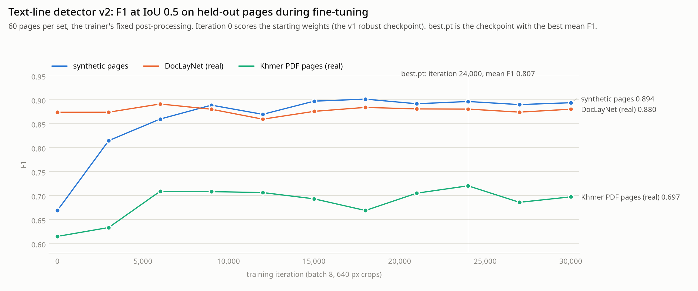

*Figure 11.1. Held-out F1 every 3,000 iterations. Synthetic pages gain the most; the Khmer PDF set (silver line
boxes, few pages) is noisy.*

| Iteration | Synthetic | Khmer PDF | DocLayNet | Mean (5 sets incl. low-res) |
|---:|---:|---:|---:|---:|
| 0 (v1 robust) | 0.669 | 0.615 | 0.874 | 0.725 |
| 6,000 | 0.859 | 0.709 | 0.891 | 0.797 |
| 15,000 | 0.897 | 0.693 | 0.876 | 0.804 |
| **24,000 (kept)** | **0.896** | **0.720** | **0.880** | **0.807** |
| 30,000 | 0.894 | 0.697 | 0.880 | 0.799 |

**v1 against v2, final evaluation** (100 held-out pages per set, best post-processing setting for each model,
`work/reviews/textdet_eval.json`):

| Set | v1 robust | v2 |
|---|---:|---:|
| synthetic (docgen v2 + exam sheets) | 0.806 | **0.923** |
| real Khmer PDF | 0.865 | **0.877** |
| real DocLayNet | **0.886** | 0.877 |

Both models do best with an unclip ratio of 1.6, not the old demo default of 2.0 with vertical growth × 1.12, because
the training boxes are tight to the ink; only v2 on the Khmer PDF pages prefers to keep the × 1.12 growth. With the
old default settings v2 scores 0.864 / 0.858 / 0.826 and v1 0.633 / 0.792 / 0.836. v2 became the default
(`db_ppocrv5_khmer_v2`).

### 11.4 Inference

The page is resized so that its long side lies between 1600 and 2200 px (a multiple of 32), normalised with the
ImageNet mean and standard deviation, and run once. Lower tiers in the browser use 1600–1800 px or 1100–1300 px.
The *cascade* then runs the detector again on an enlarged crop of every text region in which the page pass found
almost nothing. Since phase 3 the server also runs a *handwriting pass*: when the layout model finds handwriting, the
page is detected again at 1600 px and the larger box wins, which raised the lines found on the owner's real exam
photos from 5, 5 and 7 to 8, 17 and 21.

---

## 12. Line recogniser

### 12.1 Architecture

The recogniser is a CRNN with CTC (`khmerocr/model.py`). One design is used in three widths:

| Layer | Output size (height × width × channels) |
|---|---|
| input: grey line, height 48, any width W | 48 × W × 1 |
| 3 × 3 conv + batch norm + ReLU (c₀), 2 × 2 max-pool | 24 × W/2 × c₀ |
| 2 × (3 × 3 conv + BN + ReLU) (c₁), 2 × 2 max-pool | 12 × W/4 × c₁ |
| 2 × (3 × 3 conv + BN + ReLU) (c₂), 2 × 1 max-pool | 6 × W/4 × c₂ |
| 2 × (3 × 3 conv + BN + ReLU) (c₃), 2 × 1 max-pool | 3 × W/4 × c₃ |
| reshape: one feature vector per column | T = W/4 steps of 3·c₃ |
| linear projection + ReLU + dropout 0.1 | T × p |
| 2-layer bidirectional LSTM, dropout 0.1 | T × 2h |
| linear layer | T × 195 logits (index 0 = CTC blank) |

| Arch | Channels c₀–c₃ | Projection p | LSTM h | Parameters | ONNX fp32 / int8 | Used by |
|---|---|---:|---:|---:|---|---|
| S | 32, 64, 128, 192 | 256 | 192 | 2,633,123 | 10.5 / 2.7 MB | phase 1, repo-only model |
| **M** | 48, 96, 192, 256 | 320 | 256 | **4,763,795** | **19.1 / 4.8 MB** | v1 to v2.4 |
| L | 64, 128, 256, 320 | 384 | 288 | 6,798,019 | not exported | comparison only |

The first two pooling steps halve the width, so every output step covers 4 pixel columns of the line; the last two
pool only vertically, keeping the time resolution that Khmer's narrow clusters need. A label must fit into W/4
steps including the blanks CTC needs between repeated characters; lines that do not fit are dropped when the
dataset is loaded (598 of 829,802 in experiment A).

### 12.2 Input, decoding and outputs

The input is a grey crop of height 48 scaled to [−1, 1] with white paper at +1. In the pipeline each detected line
is cut from the page along its rotated quadrilateral with a small margin, straightened, resized to height 48 and
clamped to widths of 16–4,200 px; crops are sorted by width and run in batches of 16. Decoding is greedy: the most
likely symbol per step, repeats collapsed, blanks removed. The line confidence is the mean of the maximum
probabilities of the emitted steps. The step index of each emitted character gives its approximate horizontal
position, which the pipeline uses to cut words for word-level bold and to place word boxes.

### 12.3 Training procedure

The trainer (`Khm-Dataset-Creation/scripts/train.py`, wrapped by `training/rec/train.py` to add packed line sets and
the L arch) has these properties:

| Aspect | Setting |
|---|---|
| Loss | CTC, blank 0, infinite losses zeroed |
| Optimiser | AdamW, weight decay 0.01, gradient clipping at norm 5 |
| Schedule | 6 % linear warm-up, then cosine decay to 0.5 % of the peak |
| Averaging | exponential moving average of the weights (decay 0.9995); the EMA weights are evaluated, kept and exported |
| Precision | bfloat16 autocast |
| Batches | width-bucketed: at most 128 lines and 48,000 padded columns per batch, so batch size varies with line length (about 95–100 lines on average) |
| Data loading | all line images packed into one shared memory buffer; workers start with `fork` (Python 3.14 defaults to `forkserver`, which would copy the buffer into every worker) |
| GPU sharing | memory capped at 2.6 GB (L: 5.0 GB); training pauses while the GPU is above 84 °C; resumable from `last.pt` |
| Checkpoint choice | `best.pt` = lowest CER on V01 (synthetic printed Khmer); all other validation sets and the real signboard dev set are logged every epoch for monitoring |

**Strong augmentation** (on the GPU, per sample unless stated): with probability 0.7 an affine warp (slant up to
±0.3 of the height, baseline drift, vertical zoom and shift of up to 8 %, horizontal squeeze of up to 10 %; widths and
glyph order are kept so the labels stay valid); with probability 0.5 per batch a low-resolution pass (shrink by 1.3–2.6
and enlarge again) on 40 % of the lines; gamma 0.7–1.5 on 30 %; polarity inversion on 8 %; contrast and brightness
jitter; Gaussian noise on 30 %; and with probability 0.5 a horizontal stretch of the whole batch by 0.88–1.12.

**Stamp augmentation** (`training/rec/stamp_aug.py`, `STAMP_AUG=p`): on a fraction p of the training crops, one or two
arcs of a large circle (radius 1.5–4 line heights, centre possibly outside the crop, stroke 5–12 % of the height) and
3–9 short wavy strokes along the ring are drawn in light grey (70 % of cases, as after the pipeline fades a red
stamp) or mid grey (30 %, as when the stamp was not detected), optionally blurred, and combined with the line by a
per-pixel minimum, so the text under the stamp stays dark.

### 12.4 Lineage

Each version starts from the previous best checkpoint, except v1 and L, which start from random weights.

| Version | Run | Start | Mix (Section 5.5) | Epochs | Peak lr | Min per epoch | Kept epoch |
|---|---|---|---|---:|---:|---:|---:|
| v1 (`crnn_m_v1`) | `crnn_m` (28–29 Oct) | scratch | `mix_print_scene` | 6 | 1.5e-3 | 19.7 | 6 |
| expA | `rec_expA` (1 Nov) | v1 | `exp_a_doclaynet` | 2 | about 1e-3 (inferred from the warm-up in the log) | 25–30 | 2 |
| v2 (`crnn_m_v2`) | `rec_v2_M` (7–8 Nov) | expA | `final_v2_hand` | 6 | 1e-3 | 30–64 | 6 |
| v2.1 (`crnn_m_v2_hw`) | `rec_v2_M_ft` (8 Nov) | v2 | `final_v2_hand_real` | 3 | 5e-4 | 30.8 | 3 |
| L (comparison) | `rec_v2_L` (8 Nov) | scratch | `final_v2_hand_real` | 8 | 1.5e-3 | 57 | 8 |
| v2.2 (`crnn_m_v2_stamp`) | `rec_v2_M_stamp` (9 Nov) | v2.1 | same + stamps 25 % | 2 | 3e-4 | 24.8 | 2 |
| **v2.3** (`crnn_m_v2_stamp2`, default) | `rec_v2_M_stamp2` (9 Nov) | v2.1 | same + stamps 12 % | 4 | 1.2e-4 | 24.5 | 2 |
| v2.4 (`crnn_m_v2_stamp3`) | `rec_v2_M_stamp3` (9 Nov) | v2.3 (`last.pt`) | same + stamps 12 % | 4 | 1e-4 | 24.6 | 3 |

Validation CER (%) of the kept checkpoint, spaces counted. "v2" is the synthetic scene/document validation set,
"real dev" the 2,200 real signboard crops:

| Version | V01 print | v2 scene/doc | English real | docgen print | exam hand | form hand | Thareah real hand | SoyVitou real hand | real dev |
|---|---:|---:|---:|---:|---:|---:|---:|---:|---:|
| v1 | 0.294 | 3.238 | – | – | – | – | – | – | 14.83 |
| expA | 0.286 | 3.172 | 0.389 | – | – | – | – | – | 14.83 |
| v2 | 0.219 | 2.832 | 0.303 | 7.709 | 4.764 | 4.036 | – | – | 13.58 |
| v2.1 | 0.229 | 2.799 | 0.300 | 7.627 | 4.698 | 3.698 | 21.71 | 10.23 | 13.05 |
| L | 0.223 | 2.894 | 0.290 | 7.431 | 4.254 | 3.769 | **18.67** | **8.51** | 13.37 |
| v2.2 | 0.223 | 2.765 | 0.294 | 7.607 | 4.588 | 3.804 | 21.11 | 9.82 | 12.89 |
| **v2.3** | **0.216** | 2.759 | 0.291 | 7.553 | 4.561 | 3.822 | 21.53 | 9.95 | 12.72 |
| v2.4 | 0.211 | 2.731 | 0.291 | 7.450 | 4.452 | 3.538 | 21.40 | 9.51 | 12.66 |

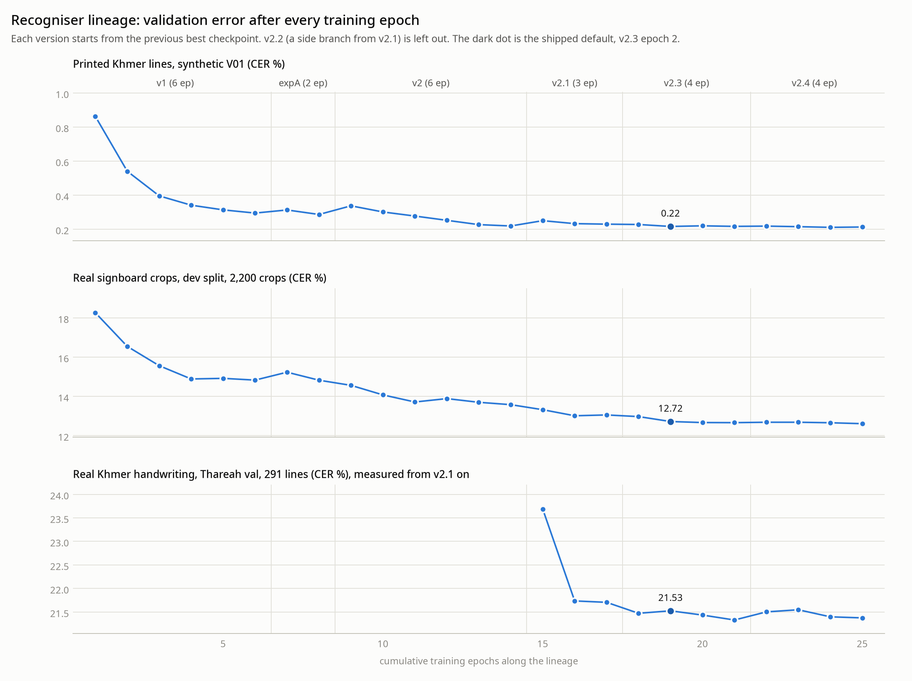

*Figure 12.1. Validation error after every epoch along the main line v1 → expA → v2 → v2.1 → v2.3 → v2.4.*

### 12.5 Held-out tests

**Phase 2 suite** (CER with spaces ignored, the same scored lines for every model, `eval_suite.py`):

| Set | Phase-1 model (S, 24 epochs) | Repo-only (S, 8 epochs) | **v1** (M, print + scene) |
|---|---:|---:|---:|
| real signboards (5,171 crops) | 16.1 | 72.9 | **14.1** |
| real printed PDF lines (680, noisy references) | 14.6 | 15.7 | **14.0** |
| printed news lines (T01) | 0.80 | **0.10** | 0.29 |
| synthetic scene + document / unseen fonts | 3.0 / **2.8** | 36.4 / 37.2 | 3.0 / 2.9 |
| long 30–40-word lines | **5.0** | 25.6 | 5.5 |
| CPU time per line, ONNX fp32 | 6.0 ms | 8.5 ms | 11.6 ms |

**Phase 3 suites** (test splits, never trained on; folder sets count spaces, the signboard suite ignores them):

| Set | v1 | v2 | v2.1 fp32 | v2.1 int8 |
|---|---:|---:|---:|---:|
| real English lines (DocLayNet test, 3,000 lines) | 3.74 | 0.83 | 0.86 | 0.86 |
| real Khmer signboards (5,171 crops) | 14.10 | 13.07 | 12.90 | 12.95 |
| printed news lines (T01) | 0.29 | 0.22 | 0.21 | – |
| long lines | 5.50 | 5.15 | – | – |
| synthetic documents (docgen test) | 12.95 | 7.41 | 7.32 | 7.33 |
| synthetic exam handwriting | 24.18 | 2.44 | 2.42 | 2.43 |
| synthetic form handwriting | 21.95 | 5.10 | 5.11 | 5.09 |
| **real Khmer handwriting, Thareah test (289 lines)** | 80.5 | 75.1 | **26.1** | 25.9 |
| **real Khmer handwriting, SoyVitou test (307)** | – | 30.1 | **10.0** | 10.1 |

On the real signboards the error grows with the height of the crop (v2.1: 8.0 % below 24 px, 7.6 % at 24–36 px,
12.3 % at 36–60 px, 18.3 % above 60 px): large sign lettering is harder for this model than small text.

### 12.6 Decisions along the lineage

- **Real English lines (expA).** 90,860 real DocLayNet lines cut English error by a factor of four (3.9 % → 0.9 %)
  and left Khmer unchanged or better.
- **Synthetic handwriting (v2).** The exam and form handwriting lines cut synthetic handwriting error tenfold, but
  real student handwriting stayed at 75 %: synthetic handwriting fonts are much neater than real writing.
- **Real handwriting (v2.1).** 5,860 real lines, oversampled to 32,684 slots per epoch (3 % of the mix), cut real
  handwriting error from 75 % to 26 % on the Thareah test lines and from 30 % to 10 % on SoyVitou, with print
  unchanged. This was the largest single gain of the project for the least data.
- **The L model.** Trained from scratch on the same mix, the 43 % larger L model was better on handwriting (18.7 %
  against 21.7 % on Thareah validation lines) and on synthetic sets, but worse on the real signboard crops (13.37 %
  against 13.05 %), and it is not a fair comparison because M had many more epochs behind it. It was not adopted,
  to keep the model phone-sized.
- **Stamps (v2.2 → v2.4).** v2.2 (25 % stamp overlays, lr 3e-4) was slightly better on every validation set and read
  the stamped lines of the ministry statement correctly, but misread several printed lines on the real pages, so it
  was not made the default. v2.3 (12 %, gentler learning rate, 4 epochs) fixed 7 lines on five real pages (a date
  under a stamp, an e-mail address, the motto word ព្រះមហាក្សត្រ, the leading letter of a long word, a place name, a
  phone separator, an acronym) and broke 3 (a vowel sign, a missing slash in a decree number, a page number read as
  2/2 instead of 1/2), and became the default. v2.4 was better again on every validation set but net 2 lines worse on
  the same pages; it is offered as an option and used by the browser's "Best quality" tier.
- **The noise floor.** After v2.3 the fine-tunes flipped the same marginal lines back and forth. The project's notes
  conclude that the next gain needs more real labelled lines, not more epochs. The browser app's "Export corrected
  lines" feature (Chapter 17) exists to collect them.

### 12.7 int8 and speed

The int8 models are dynamic quantisations of the same checkpoints (`training/rec/export.py`): 4.8 MB instead of
19.1 MB and the same error within 0.05 points on every set. On the development machine's x86 CPU with ONNX Runtime
they are *slower*, not faster: 31–34 ms against 11–13 ms per 48 × 400 line with four threads. The int8 twin is
therefore chosen for download size (phones, slow links), not for speed; its speed inside the browser was not
measured separately.

---

## 13. Font classifier

### 13.1 Purpose

A Word-like rebuild needs to know how each line looks: its typeface, whether it is bold or italic, and its size.
The font classifier answers these four questions per line from the line crop alone.

### 13.2 Architecture

`FontNet` (`training/font/model.py`) has four convolution blocks of two 3 × 3 convolutions each (8 convolutions in
all, batch norm and ReLU), widths 24, 48, 96 and 144, with 2 × 2 max-pooling after the first three. The 32 × 256
input becomes a 4 × 32 × 144 feature map, which is pooled by both average and maximum over all positions into 288
features. After dropout 0.2, four linear heads predict the family (29 classes), the weight (regular or bold), the
slant (upright or italic) and, from v2 on, the logarithm of the *em ratio*, the font size in pixels divided by the
height of the line crop. The network has 483,034 parameters (1.9 MB as ONNX). The ONNX export carries the label
lists in its metadata, so no side file is needed.

### 13.3 Training data

All training data is synthetic and rendered on the fly (`training/font/gen.py`), one sample per call, in worker
processes. A sample imitates what the pipeline hands over: a detector box around one printed line with a little
margin, from a scan or phone photo. Text comes from the Khmer news corpus with Latin tokens and English sentences.
Each line is drawn with Raqm shaping in one of 29 families at a random size of 30–80 px, in a random colour, with
padding of 25–60 % of the size, sometimes with neighbouring lines intruding at the top or bottom and sometimes
underlined. Bold is either a true bold font file (weight ≥ 700) or synthetic bold by dilating the ink, as Word does
for fonts without a bold face; italic is a shear. Degradations: resolution loss, blur, noise, JPEG, a paper tint or a
low-frequency lighting gradient, and the crop is brought to height 32, sometimes through a smaller height first to
imitate small print. Because the renderer knows the font size, the em ratio label is exact. Validation uses 8,000
fixed crops from the held-out news split. At inference a 32 px line crop narrower than 256 px is centred on a
background of its own edge colour; a wider one is cut into up to three evenly spread 256 px windows whose
predictions are averaged.

| Group | Families (29) |
|---|---|
| Khmer OS (Danh Hong, LGPL) and their Google re-releases, reported as one family each | Khmer OS, Khmer OS System, Khmer OS Battambang, Khmer OS Content, Khmer OS Siemreap, Khmer OS Muol, Khmer OS Muol Light, Khmer OS Muol Pali, Khmer OS Bokor, Khmer OS Metal Chrieng, Khmer OS Fasthand, Khmer OS Freehand |
| Other Unicode Khmer faces | Noto Sans Khmer, Noto Serif Khmer, Khmer Digital, Hanuman, Kantumruy Pro, Nokora, Odor Mean Chey, Chenla, Preahvihear, Suwannaphum |
| Khmer display faces | Koulen, Dangrek, Bayon, Angkor, Taprom |
| Latin | Latin serif, Latin sans |

### 13.4 Training and results

| | v1 (`font_cnn_v1`) | v2 (`font_cnn_v2`, default) |
|---|---|---|
| Start | scratch | v1 |
| Schedule | 40 epochs × 400 steps × batch 256 (4.1 M crops), 78 min | 24 epochs, 48 min, peak lr 1.5e-3 |
| Optimiser | AdamW (weight decay 1e-4), one-cycle schedule with 15 % warm-up | same |
| Loss | cross-entropy for family (label smoothing 0.05) + 0.5 × weight + 0.5 × slant | + smooth-L1 on the log em ratio (trainer default weight 4) |
| Kept epoch | 36 | 20 |
| Family / weight / slant accuracy | 92.3 % / 97.7 % / 99.98 % | 92.3 % / 97.8 % / 99.9 % |
| Size: median relative error / within 10 % | – | 1.8 % / 97.7 % |

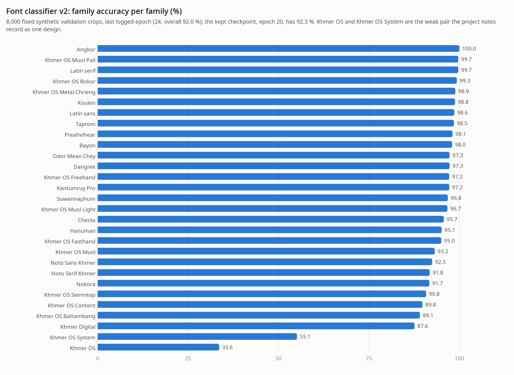

*Figure 13.1. Family accuracy per family at the last logged epoch of v2.*

Display faces and Latin faces are almost always right (95–100 %). Body faces that share a design are confused with
each other: Khmer OS (33.6 %) and Khmer OS System (55.1 %) are the project's "weak pair", recorded in its notes as one
design; Khmer OS Battambang, Content and Siemreap and Khmer Digital sit at 87–91 %. For a document rebuild these
confusions are mild, because the confused faces look alike.

### 13.5 Use in the pipeline

The pipeline classifies every printed line of two or more characters. A block gets one typeface by a width-weighted
vote of its lines, and bold or italic when more than half of its line width is. The block's font size is the median
of its lines' predicted sizes (`font_src: "model"`); the old ink-height estimate is only a fallback. On the
scholarship notice used for testing, the size head turned three spurious size levels (13.9, 15.7, 18.2 px) into one
(11.9 px, 12 pt). The weight head is also used word by word: words are cut using the recogniser's character
positions, each word crop is classified, and runs of bold words become bold spans (in the browser for lines the model
is unsure about or that start with a label such as "សំណុំលិខិត៖"). In the server a word is bold when the model is
very sure, or when it leans bold and the strokes are measurably thicker and darker than the page's typical word.

---

## 14. Structure model

### 14.1 Problem

After recognition, a page is a set of lines with boxes and text. The structure model predicts, for every line, its
role (12 classes: text, title, section_header, list_item, caption, header, footer, page_number, footnote, table,
form_field, other), whether it starts a new paragraph, its list level (0–3), whether it carries a list marker, and
which line follows it in reading order.

### 14.2 Inputs

Each line becomes 23 numbers and 6 hashed character ids. Lines are first sorted top to bottom by centre, and pages are
capped at 256 lines.

| Features | Meaning |
|---|---|
| x0, y0, x1, y1, w, cx, cy | box position and width relative to the page |
| h_rel, size_rel | height relative to the page's median line height (size capped at 4) |
| left_off, right_gap | distance from the page's text margins (5th / 95th percentiles of the line edges) |
| khmer, digit, latin, upper | share of each character kind |
| len | log of the text length |
| starts_marker, ends_terminal | a list marker at the start; ។ . : ៖ ! ? at the end |
| bold, bullet | from the font model and the bullet detection |
| gap_above, gap_below | vertical gaps to the neighbouring lines in median line heights (clipped to −2 … 6) |
| n_lines | number of lines on the page / 256 |
| char ids (6) | the first three and last three characters, hashed into 2,047 buckets (0 = padding) |

### 14.3 Architecture

`StructureNet` (`training/structure/model.py`): a two-layer MLP (23 → 160 → 160, GELU) embeds the features; a 24-wide
embedding of each of the six character ids, concatenated and projected to 160, is added. A pre-norm Transformer
encoder with 4 layers, 4 heads, width 160, feed-forward 320, GELU and dropout 0.1 lets every line attend to every
other line. Four linear heads give role, paragraph start, level and bullet. The reading-order head is a pointer
network: line *i*'s successor scores are the scaled dot products of a query projection of line *i* with key
projections of all lines plus a learned end-of-page token, a line cannot point to itself, and padding is masked. The
model has 983,412 parameters (4.0 MB as ONNX).

**Decoding the order.** The successor matrix is turned into probabilities. The first line is the one least often
chosen as anybody's successor (ties broken by the highest position). From there the decoder follows the most likely
unused successor until it reaches the end-of-page token, then restarts from the least-pointed-to unused line, until
every line is placed.

### 14.4 Data and training

The labels come from docgen v3, where every printed line records its paragraph, role, level, list item, marker,
paragraph start and indent (Section 6.6); markers drawn as separate glyphs are merged into their line as the pipeline
does. Training used 9,786 v3 pages (pages without usable structure are skipped) and 400 validation pages. Training
augmentation imitates real captures: in 30 % of pages a photo-like window keeps only part of the page, in 15 % some
lines are dropped, and every box is jittered by Gaussian noise of 0.12 line heights. The loss sums cross-entropy for
role, level and bullet (weight 0.5), and weighted cross-entropy for paragraph start (1.5, class-weighted) and the
successor pointer (1.5). AdamW (lr 3e-4, weight decay 0.01) with a one-cycle schedule, batch 16, gradient clipping
at 2, 30 epochs in 4.5 minutes on the GPU.

### 14.5 Results

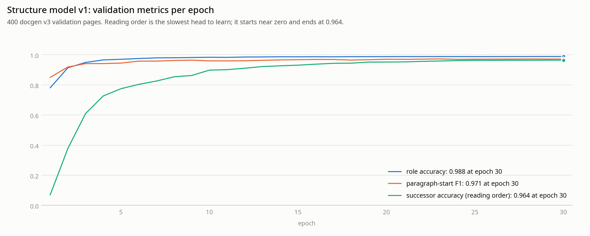

*Figure 14.1. Validation metrics per epoch.*

| Metric (400 synthetic validation pages, kept epoch 29) | Value |
|---|---:|
| role accuracy | 98.8 % |
| list level accuracy | 99.3 % |
| bullet accuracy | 100 % |
| paragraph-start F1 | 0.971 |
| successor accuracy | 96.4 % |
| Kendall's tau of the decoded reading order | 0.943 |

### 14.6 On real pages

In the server the model sets block roles (section headers, page numbers, …) and the order of blocks, and adds
paragraph starts that the rules missed; tab-stop levels stay with the rules. On four real test pages it found the
lettered headings (ខ) គ) ឃ)), kept the letterhead and footer columns, and caused no regression. Two weaknesses
appeared. It put the top line of a ministry footer last, next to a ruling line, a situation docgen v3 does not
produce, so within a block the server accepts the model's order only if it never goes back up to an earlier row. And
in the browser's "models only" experiment (Section 17.8) its grouping and order were clearly worse than the rules on
label/value pages, tables of contents and paragraphs. A version 2 needs training pages with footers beside rules,
label columns and dot-leader lines.

### 14.7 Export

PyTorch's fused attention bakes the traced sequence length into the ONNX reshapes, so a naïve export runs only for
pages with exactly that many lines. `training/structure/export.py` re-implements the encoder layers with explicit
attention for the export, which gives a graph with a dynamic number of lines (`feats [1, n, 23]`, `chars [1, n, 6]`).

---

## 15. Export, size and speed

### 15.1 Contracts

All models are ONNX, opset 17, fp32 unless marked int8. A model is described in `models.json` by its id, stage, kind,
file, sha256, input size, version and label (plus the vocabulary file for recognisers and the class list for layout
models).

| Stage | Input | Output | Metadata |
|---|---|---|---|
| layout | `images [1, 3, 1024, 1024]`, RGB / 255, letterboxed with grey 114 | `output0 [1, 26, 21504]` | class names (`names`) |
| text lines | `x [N, 3, H, W]`, H and W multiples of 32, ImageNet normalisation | `prob [N, 1, H, W]` | – |
| recogniser | `image [batch, 1, 48, width]`, grey in [−1, 1] | `logits [time, batch, 195]`, time = width / 4 | vocabulary in `*.vocab.json` (`itos[0]` = blank) |
| font | `image [batch, 1, 32, 256]` | `family [batch, 29]`, `weight [batch, 2]`, `slant [batch, 2]`, `size [batch, 1]` | family, weight and slant lists; size definition |
| structure | `feats [1, n, 23]`, `chars [1, n, 6]` | `role [1, n, 12]`, `first [1, n, 2]`, `level [1, n, 4]`, `bullet [1, n, 2]`, `succ [1, n, n+1]` | role list, feature names, char-id scheme |

### 15.2 Sizes of the default sets

| Tier (browser) | Layout | Text lines | Recogniser | Font | Structure | Total |
|---|---|---|---|---|---|---:|
| Best quality | v4 (10.9 MB) | v2 (4.8 MB) | v2.4 fp32 (19.1 MB) | v2 (1.9 MB) | v1 (4.0 MB) | 40.7 MB |
| Balanced, Light | v4 (10.9 MB) | v2 (4.8 MB) | v2.3 int8 (4.8 MB) | v2 (1.9 MB) | v1 (4.0 MB) | 26.4 MB |
| Server default (`.model/v2/models.json`) | v3 (10.9 MB) | v2 | v2.3 fp32 (int8 twin for phones) | v2 | v1 | 40.7 MB |

The layout v4 files were added to the browser manifest and to the Hugging Face repository; the server's own manifest
still names v3 as its default, so the server keeps using v3 until v4 is registered there.

### 15.3 Speed

Measured with ONNX Runtime on the development laptop's CPU (`work/reviews/bench_cpu_v2.json`, milliseconds):

| Model | Size | 1 thread | 4 threads |
|---|---:|---:|---:|
| layout YOLO11s (v1, v2 round 2) | 38.2 MB | 533–536 | 179 |
| layout YOLO11n (v2 nano; v3 and v4 have the same network) | 10.9 MB | 185 | 70.5 |
| text lines, DB (v1, v2), one page at 1600–2200 px | 4.8 MB | 819–826 | 357–370 |
| recogniser M fp32, one 48 × 400 line | 19.1 MB | 34.1 | 11.6 |
| recogniser M int8, one 48 × 400 line | 4.8 MB | 100.8 | 31.3 |
| font classifier, one line | 1.9 MB | – | about 1 |
| structure model, one page | 4.0 MB | – | about 2.5–3 |

On CPU most of a page's time goes to the line detector and to recognition, which grows with the number of lines. A
40-line page takes a few seconds in the browser; the app measures the device after loading and refines its estimate
after every page.

---

# Part IV. Systems

## 16. The server application

### 16.1 Architecture

The server (`backend/`, FastAPI, about 4,700 lines of Python) loads models through a manifest and runs the pipeline
on uploaded pages. Its main parts:

| Part | Files | Role |
|---|---|---|
| Configuration | `app/config.py` | every threshold and switch as an environment variable (`LAYOUT_CONF`, `DET_LONG_MIN/MAX`, `DET_CASCADE`, `REC_BATCH`, `ORT_DEVICE`, `DETECT_STAMPS`, `DETECT_BOLD`, …) |
| Model registry | `services/model_registry.py` | reads `.model/v2/models.json`, checks sha256, maps each `kind` to a stage class |
| Model pool | `services/model_pool.py` | one active model per stage, lazy loading, switching at runtime; a failed load keeps the previous model |
| Stage implementations | `services/stages/*.py` | `layout_yolo_onnx`, `textdet_db_onnx`, `rec_crnn_onnx`, `font_cnn_onnx`, `structure_onnx`, legacy PyTorch kinds, a post-correction hook |
| Pipeline | `services/pipeline_service.py` | the page pipeline (Section 16.2) |
| Page analysis | `services/doc_structure.py`, `page_structure.py`, `stamps.py`, `bold.py`, `structure_model.py`, `reading_order.py` | the rules of Section 16.3 |
| Document model | `services/document.py` | blocks → word-processor elements (Section 16.4) |
| Routers | `routers/models.py`, `pipeline.py`, `export.py` | HTTP API (Section 16.5) |

Every stage has a small interface in `services/stages/base.py`: `LayoutDetector.detect(image) → regions`,
`TextLineDetector.detect(image) → [(quad, score)]`, `LineRecognizer.recognize(crops) → [(text, confidence)]`,
`FontClassifier.classify(crops) → [{family, weight, slant, confidence, em_px}]`,
`StructureClassifier.predict(lines, W, H) → [{role, first, level, bullet, order}]` and
`PostCorrector.correct(lines, context)`. A new model with the same contract is added by copying the file into
`.model/v2/` and running `scripts/register_model.py`; a new architecture needs one new stage class and one line in
the registry.

### 16.2 The page pipeline

1. **Decode** the upload (transparent images composited on white, pages longer than 3,600 px downscaled).
2. **Layout**: regions; a `figure` covering more than half the page is ignored (a dense table mistaken for a picture),
   near-identical boxes of different classes are de-duplicated.
3. **Text lines**: the page pass at a long side of 1,600–2,200 px; the cascade re-detects inside text regions where
   the page pass found almost nothing; the handwriting pass re-detects the page at 1,600 px when handwriting is present.
4. **Assignment**: every line goes to the smallest region containing its centre; lines outside every region are
   grouped into extra `text` blocks marked `source: "orphan"`; figures that contain text lines are split.
5. **Stamps**: red round stamps are found by colour and faded on a copy of the page; lines under them are detected
   again and read from the faded copy.
6. **Snapping**: line boxes grow to glyph ink they cut; picture boxes grow to the ink they cut and are clamped against
   text.
7. **Bullets** found from the ink left of each line; **recognition** of every line of the text classes.
8. **Decorations and rules**; **relabelling by position** (header, title, footer, page number, logo).
9. **Structure**: paragraphs, indent levels, tab stops; the structure model sets roles and block order, adds paragraph
   starts, and splits headings out of body blocks.
10. **Appearance**: fonts and sizes per line and block, bold words, text colours.
11. **Layout of the page** (margins, zones, alignment) and **rendering** of the response, including the structured
    `document`.

The response for each page lists blocks (class, box, score, reading order, alignment, font, size, colour, lines,
paragraphs, crop, text) and timings per stage.

### 16.3 Page-analysis rules

All of them are numpy/OpenCV heuristics on the page's ink, each behind a switch:

| Switch | Rule |
|---|---|
| `DETECT_BULLETS` | list marks the line detector drops ("-", "o") are found in the ink left of each line and attached to it |
| (structure) | lines are grouped into paragraphs; the paragraph starts of a text column give its tab stops (`indent_level`) |
| `SNAP_CROPS` | figure, logo and stamp boxes grow to the connected ink they cut, clamped against neighbouring text |
| `DETECT_DECORATIONS` | an ornament or divider read as text (mirror-symmetric ink, low confidence or tiny) becomes a `decoration` crop; horizontal rule lines outside every block become decorations (pages with more than three such lines, such as ruled paper, are skipped) |
| `RELABEL_BY_POSITION` | `text` blocks above the body become `header`, a short centred block right above it `title`, blocks below the body `footer` or `page_number`, a small square figure at the top `logo`; the model's class is kept in `relabel` |
| (fonts) | one font size per block from the font model's line sizes, snapped to the page's size levels; consonant-height ink measurement as fallback |
| `DETECT_STAMPS` | a round saturated-red blob becomes a `stamp` block whose crop is the red ink alone; per stamp, an Otsu split of the red values on the dilated red mask separates stamp-only pixels (made white) from text under the stamp (kept dark). The plain red channel had left photographed stamps as a grey ring that the recogniser read as strokes; after the change a stamped date line on the ministry statement read exactly |
| `SPLIT_FIGURES` | a figure or logo that holds text lines (an emblem with the title under it, a footer, a loose box around two logos) is split: pictures are the ink clusters that touch no text line, extra clusters become their own blocks, the text leaves the block; boxes that are mostly not paper (photos, coloured seals) are left alone; text around pictures is re-detected at the picture's scale |
| `SNAP_LINES` | line boxes grow to glyph ink they cut (at most one line height sideways, 0.35 up and down), so a clipped first or last glyph is still read |
| `DETECT_BOLD`, `BOLD_MODEL` | word boxes come from the recogniser's character positions; a word is bold when the font model's weight head is sure (p ≥ 0.99), or leans bold (p ≥ 0.5, 0.7 for words under three characters) and its strokes survive erosion clearly better (≥ 1.25 × the page median) and are darker than the page's typical word |
| `DETECT_COLORS` | the median of the darkest ink pixels gives each line, word and block a `text_color`; neutral dark greys are reported as black |

### 16.4 From blocks to a document

`services/document.py` turns the blocks into what a word processor holds, in reading order: headings (level 1 title,
2 section header, 3 a short bold line), paragraphs (with `first_line_indent` for the Khmer indented first line and a
`level`), lists (bulleted paragraphs merged, one bullet per level), headers, footers (a `footer_row` with columns when
footer blocks share a row), page numbers, figures (crop and width fraction) and decorations, each with alignment,
typeface, size, colour and bold runs. There are no photo coordinates in it. `docview.js` reflows it inside the page
margins as an editable view, and `POST /export/docx` writes the same structure to Word with python-docx: paragraphs,
alignment, indents, bullets, fonts, sizes, colours, bold runs, logo and stamp pictures and page margins.

### 16.5 API

The v1 contract of phase 0 is unchanged; v2 adds fields and endpoints.

| Endpoint | Purpose |
|---|---|
| `GET /models`, `POST /models`, `POST /det-models` | v1 model listing and switching |
| `POST /layout-models`, `POST /pipeline/models` | switch the layout model or any stage |
| `GET /pipeline/info` | manifest, providers, active and available models per stage |
| `GET /health` | health check |
| `POST /process` | pages → blocks, lines, timings, models used, structured document |
| `POST /reprocess`, `POST /regions`, `POST /lines` | re-run a page, or re-read it with user-edited regions or lines |
| `POST /export/docx` | page results (possibly edited) → Word file |
| `GET /storage/…` | page images and crops |

Inputs are validated: page ids must be the 32-hex ids issued by `/process`, uploads over 40 MB are refused with 413,
undecodable files with 422 and nothing is stored, and user boxes must be finite and are clipped to the page.

### 16.6 Front ends and tests

Three front ends talk to the server: the classic one-page demo (`app/static`, kept on port 8010 at the owner's
request), the KhmerOCR application (`app/static_new`, port 8012), built from the owner's Figma design "Khmer Doc
Extractor" with dashboard, new job, live processing with per-stage timings, review and export with an editable
rebuilt page and a "needs review" list, documents, batch jobs, settings and help, and the original Next.js front end,
updated to show all classes with their colours and a model picker per stage. The test suite (`backend/tests`, 67
tests, about 30 seconds) covers the API, the units, robustness cases, the QA defects, document structure, page
structure, stamps, bold and the font stage.

---

## 17. ThaOCR web, the client-only application

### 17.1 Why move to the browser

A server needs hosting, sees every document, and fails without a connection. Running the pipeline in the browser
removes all three problems: the site is a folder of static files, documents never leave the device, and once the
models are cached the app works offline. The cost is that the device does the work, which the small models make
affordable.

### 17.2 Architecture

| File | Lines | Role |
|---|---:|---|
| `index.html`, `app.js`, `app.css` | 57, 875, 335 | the user interface: scan, select, documents, review, settings, help |
| `docview.js` | 207 | the reflowed, editable document view (shared with the server app) |
| `ocr/engine.js` | 364 | runtime loading, model download and caching, the five model stages with their pre- and post-processing |
| `ocr/pipeline.js` | 546 | regions → blocks → text → structure → page result (the same schema as the server's `/process`) |
| `ocr/pdf.js` | 226 | PDF input |
| `ocr/device.js` | 71 | device check, model-set recommendation, benchmark, time estimate |
| `ocr/store.js` | 23 | IndexedDB storage of documents and page images |
| `models/` | – | `models.json` and the small font and structure meta files; the ONNX files are not in the repository |
| `serve.py`, `vercel.json`, `_headers` | – | development server and hosting headers |

**Runtime.** ONNX Runtime Web 1.31.1 and the `docx` library load from jsDelivr, which sends the CORS and
cross-origin-resource headers needed under isolation. Multi-threaded WebAssembly requires cross-origin isolation, so
every host sends `Cross-Origin-Opener-Policy: same-origin` and `Cross-Origin-Embedder-Policy: require-corp`. Without
them the app still runs, single-threaded. Where WebGPU is available the layout and line detectors run on the GPU; the
recogniser, font and structure models always run on WebAssembly.

**Models.** `ThaOCR.config.modelBase` points at the Hugging Face repository `Thareah/ThaOCR-models`. The browser
downloads only the chosen model set, once, into the Cache API (`thaocr-models-v1`), and shows the download size before
the first scan. The manifest stays on the site and is always revalidated (a bug in which the development server
cached `models.json` for a year, hiding layout v4 from the settings page, was fixed on 10 November).

**Storage.** Documents, page images and edits live in IndexedDB; settings in `localStorage`. Settings → "Reset
everything" deletes all of it, including the cached models, and reports the space used before.

### 17.3 Device tiers

`ocr/device.js` checks threads, memory, mobile, WebGPU, SIMD, isolation, connection and storage, and recommends:

| Tier | When | Recogniser | Detector long side |
|---|---|---|---|
| Best quality | WebGPU, or ≥ 8 threads and ≥ 8 GB on a desktop | v2.4 fp32 | 1,600–2,200 px |
| Balanced | otherwise | v2.3 int8 | 1,600–1,800 px |
| Light | phones, ≤ 4 threads, ≤ 4 GB or data saver | v2.3 int8 | 1,100–1,300 px |

A two-second benchmark after loading measures the layout and line passes and the time per line, gives a time
estimate per page, and is refined after every finished page.

### 17.4 The pipeline in the browser

`ThaOCR.process` runs the same stages as the server, with the rules that could be ported without OpenCV and several
new ones:

1. Layout regions, cleaned (page-sized figures and duplicates removed).
2. Page-level line detection and the cascade inside text regions without lines.
3. Assignment of lines to the smallest containing region (stamps and signatures excluded). A `decoration` region that
   swallowed two or more text lines (a whole letterhead band) gives them back, and is dropped when it is large or
   contains a logo, stamp or QR code. Orphan lines that lie mostly inside a stamp box and are clearly narrower than it
   are the stamp's own curved text and are removed. Lines touching a stamp are marked.
4. Grouping (rules mode): orphan lines into blocks, consecutive blocks into paragraphs, side-by-side blocks whose
   lines share baselines into a borderless table, and the segments of one printed row tagged so they can be joined.
5. Recognition. Each line is cut at height 48. A line whose crop contains a dot leader (a run of at least 2.5 line
   heights holding only short dot-like blobs) is split, and the text before and after the dots is read separately
   and joined with a tab; this fixed tables of contents in which the recogniser dropped the page number after long
   rows of dots. A small blob read as `o`, `-`, `•` and similar becomes a bullet glyph.
6. A second opinion: lines with confidence under 0.6 are read again by the handwriting-trained recogniser
   (`crnn_m_v2_hw_int8`, downloaded on first need); the second reading wins when it is more than 0.12 more confident.
7. Row segments joined, with a page number far to the right turned into a tab.
8. Fonts per line; word-level bold for lines the model is unsure about or that start with a label such as
   "សំណុំលិខិត៖", restricted to body text of normal height.
9. Assembly: bullet glyphs merged into their lines, list markers recognised at the start of a line, label columns
   turned into label/value tables (rules mode), the structure model, block fonts and sizes (from the PDF when the page
   came from a text layer), margins and alignment, reading order (XY-cut, or the structure model's order in models-only
   mode), and the table grids.

**Tables** are rebuilt from the lines of a `table` block. The block is de-skewed by the median angle of its lines,
because a tilt of one degree chains the cells of neighbouring rows. Ruling lines are found by ink projections on a
straightened copy of the region. Columns come from vertical rules, or else from clusters of line left edges; rows from
horizontal rules, or else from baselines. When a scan has lost a faint rule, a tall band that holds several baseline
rows each starting a record (text in the first column) is split at those rows. A row whose only text spans several
columns becomes a spanning group header (borderless tables accept it only at the left edge). Continuation lines
without a first-column entry join the record above. Columns of numbers are right-aligned. Tables are exported to Word
as real tables with spanning cells.

**Label columns.** A narrow column of labels at the left margin (bold or ending in "៖" or ":") whose rows line up
with wider value blocks becomes one borderless table, label column first. Before this rule, the reading order emitted
all labels and then all values, which made pages such as university notices unreadable.

### 17.5 PDF input

pdf.js (version 6.5.438, from jsDelivr) opens the file, and each page becomes a page of one document:

- **Text layer first.** A page whose text layer is usable (at least 40 characters, not damaged) is taken directly:
  exact text, the PDF's own font sizes (`font_src: "pdf"`), no detector or recogniser, well under a second. Only the
  font and structure models (6 MB) are loaded, to label headings and lists.
- **ActualText.** PDFs written by Skia (Chrome, Google Docs, Android) draw Khmer as shaped glyphs and keep the real
  text in `/ActualText` marked-content spans, which pdf.js ignores; read naïvely, the text comes out in visual order
  with subscripts lost. `ocr/pdf.js` lexes the page's content stream itself, collects the `ActualText` strings and
  substitutes them for the matching marked-content items.
- **Damage checks.** A text layer is rejected and the page is OCRed instead when it looks broken (NUL glyphs, vowel
  signs starting words) or when it was typed in a legacy font: the font name matches a legacy family, or the text
  has implausible patterns such as capitals and accented letters inside words (more than 7 %).
- **Scans.** Pages without text are rendered at 2,200 px and go through the full pipeline. "Run OCR instead" forces
  OCR for any page.

### 17.6 Review, editing and export

A PDF becomes one document whose pages are stacked in one scrollable review, painted lazily at display resolution so
that a 132-page PDF does not exhaust memory. The review shows the original with boxes (zoom, full-screen viewer), the
reflowed document view or an overlay, and a "check these lines" list of low-confidence lines; any text can be edited
in place. "Run OCR again" re-reads a page or a whole document with the current settings. Export writes Word (with
tables, tab stops with dot leaders, bold runs, fonts and sizes), plain text or JSON. Every line a user corrects is a
(line image, text) pair; Settings → "Export corrected lines" writes them as a JSON file of PNG crops and texts for
fine-tuning the recogniser. A "Select" page reads only a dragged area of an image. Settings offer the device tier, the
compute back end, a model per stage and the page-analysis mode.

### 17.7 Responsiveness and polish

The review layout keeps the title width and wraps its toolbar on narrow screens, and the grid collapses by width
(breakpoints at 1,280 and 960 px). The original page has a lightbox for a full-size view.

### 17.8 Rules or models? An experiment

The owner asked to "remove all rule base and only use the model". Before doing so, the app gained a switch
(`ThaOCR.config.rules`, Settings → Page analysis). With rules off, lines outside layout regions become one block
each, the structure model groups consecutive orphan lines that it does not mark as paragraph starts, orders the
lines inside every block and orders the blocks, and the geometric grouping, aligned-column tables, row joining,
label tables and XY-cut are skipped. Nine test pages were processed both ways:

| Page | Models only | Models + rules |
|---|---|---|
| table of contents | page numbers separated from their titles; one line broken into two or three paragraphs | title, tab, page number on one line |
| university notice with a label column | several labels emitted after the date block | label/value table in reading order |
| scholarship notice | one paragraph per line | paragraphs intact |
| stamped ministry statement | one paragraph per line; letterhead lines no longer in columns | paragraphs and letterhead columns intact |
| notice with a table | sentence fragments around the table out of order | correct order |
| notice with bold labels | one paragraph per line | paragraphs intact |
| letterhead with a list and counts | mixed: a list kept in one piece that the rules split in two, but the two lines of the institution block swapped | list split around a stray line, letterhead in order |
| handwriting form | one handwritten line moved | – |
| tilted page | identical | identical |

Six of the nine pages were clearly worse with models only, one was mixed, one changed a single line and one did not
change. The rules therefore stay on by default and the switch stays available.
The structure model was trained only on docgen v3 pages, which contain none of these hard cases; Chapter 20 lists
the data a version 2 needs.

### 17.9 Hosting and distribution

- **Code.** GitHub `chestharastan/ThaFlow-OCR`. The first push carried model files; the history was rewritten into a
  single clean commit and the ONNX files, the `vendor/` copy of the runtime and local test pages were git-ignored,
  which took the repository from 12.4 MB to about 1.5 MB.
- **Site.** Vercel serves the folder as static files; `vercel.json` sets the isolation headers and caching (the HTML,
  scripts and manifest revalidate on every load).
- **Models.** Hugging Face `Thareah/ThaOCR-models`: 31 files (282.9 MB) at the first upload on 9 November, then layout
  v4 and its int8 twin on 10 November, with the manifest and a model card that gives the training of each stage and
  the licence of each file.

### 17.10 Not yet ported

The OpenCV-based rules of the server are not in the browser: red-stamp lifting and reading text under stamps (a
simple whitening of stamp ink exists but is off, because it made the text under the stamp read worse), ink-based
bullet detection, bold by stroke weight, text colours, figure splitting, box snapping and rule-line decorations.

---

# Part V. Results and discussion

## 18. Evaluation summary

### 18.1 What was measured where

| Stage | Synthetic validation | Real held-out data | Real pages checked by eye |
|---|---|---|---|
| Layout | docgen pages in every validation set (mAP per class) | DocLayNet pages (human labels); Khmer PDF pages (silver labels); signature and stamp scans (v1 only, AP50) | the owner's test pages after each version |
| Text lines | docgen and exam pages | Khmer PDF pages (exact text-layer lines); DocLayNet pages | exam photos (lines found) |
| Recogniser | V01 print, scene/document, long lines, docgen, synthetic handwriting | real English lines (DocLayNet); real signboards (dev and test); real Khmer handwriting (Thareah, SoyVitou) | five real pages, line by line, before each default change |
| Font | 8,000 rendered crops | – | sizes and families on three real pages |
| Structure | 400 docgen v3 pages | – | four real pages; nine test pages in the rules study |

### 18.2 The current default models

| Stage | Default | Size | Main result |
|---|---|---:|---|
| Layout | v4, YOLO11n, 22 classes | 10.9 MB | mAP50-95 0.850 on the v4 set, 0.845 on the v3 set (v3: 0.802 / 0.848) |
| Text lines | v2, DB PP-OCRv5 mobile | 4.8 MB | F1 0.923 synthetic, 0.877 real Khmer PDF, 0.877 real DocLayNet |
| Recogniser | v2.3, CRNN-CTC M (int8 twin 4.8 MB; v2.4 in the browser's best tier) | 19.1 MB | CER 0.216 % synthetic print, 0.29 % real English, 12.7 % real signboards (dev), 21.5 % / 9.95 % real handwriting (val); test: 26 % / 10 % for v2.1 |
| Font | v2 | 1.9 MB | family 92.3 %, weight 97.8 %, slant 99.9 %, size median error 1.8 % |
| Structure | v1 | 4.0 MB | role 98.8 %, paragraph-start F1 0.971, successor 96.4 %, Kendall 0.943 |

### 18.3 Evidence from real pages

- **Recogniser defaults** were decided line by line on five real pages: v2.3 fixed 7 lines and broke 3 against v2.1;
  v2.4 was net 2 lines worse than v2.3, so it was not made the default despite better validation numbers.
- **Browser regression pages.** The stamped ministry statement and the scholarship notice are processed after every
  change to the browser pipeline. Their results stayed at 28 and 33 lines with mean recogniser confidence 98.6 % and
  98.5 % through the changes of 9–10 November. Mean confidence is not accuracy; it shows that a change did not break
  reading, nothing more.
- **Failures reported by the owner and their fixes** (9–10 November):

| Reported problem | Cause | Fix |
|---|---|---|
| A PDF typed in a legacy Khmer font gave garbage text | the legacy-font text layer passed the damage check | legacy-font detection by font name and letter patterns; the page goes to OCR |
| Khmer text from Chrome-made PDFs in the wrong order | real text hidden in `ActualText` marks | content-stream lexing and substitution |
| Table of contents lost page numbers | recogniser dropped the number after long dot leaders | dot leaders split on the crop, parts read separately, joined with a tab |
| Aligned name/count columns read row by row out of order | no notion of columns in a text block | side-by-side blocks sharing baselines become a borderless table |
| Tilted table rows chained together | a 1° tilt crosses row boundaries | de-skew before building the grid; rules found on a straightened copy |
| Labels and values separated | XY-cut emits the label column first | label columns become label/value tables |
| Fee table collapsed into one giant row | faint horizontal rules lost by the scan | split tall bands at rows that start a record; chain continuation lines (checked on test pages, not yet on the reported page) |
| Emblem band swallowed the motto lines | a large `decoration` box took the text | decorations holding text give the lines back |
| Stamp text appeared as document text | the stamp's curved text was read | orphan lines inside a stamp box removed |
| Bold labels shown as regular | only line-level weight was used | word-level bold from the font model |
| Logos, stamps and handwritten numbers on notices | layout v3 had not seen such pages | docgen v4 and layout v4 |

### 18.4 What has not been measured

- **Real Khmer layout accuracy** with human labels: only silver labels exist, so the v4 gains are measured on synthetic
  pages and on the owner's test pages by eye.
- **End-to-end page accuracy**: no real Khmer page set with full transcriptions and boxes was used for scoring;
  KhmerEduDoc (page transcriptions, evaluation only) was converted for this purpose but no score is reported here.
- **Speed in browsers** by device class (only the in-app estimate exists), and the speed of the int8 recogniser in
  WebAssembly.
- **The handwriting class on real pages**: the 0.749 mAP50-95 of v4 is on synthetic handwriting.

---

## 19. Lessons learned

1. **Synthetic data with exact labels carries the training; real data moves the hardest numbers.** Every model was
   trained mostly on rendered data. The largest single improvements came from small real sets: 5,860 real handwriting
   lines cut real handwriting error from 75 % to 26 %; 90,860 real English lines cut English error from 3.9 % to 0.9 %;
   a few thousand real signature and stamp scans raised signature AP50 from 0.18 to 0.93.
2. **Replay prevents forgetting, and its share matters.** v1 round 2, trained on real scans with a thin replay of the
   Khmer pages, lost Khmer text-block AP50 (0.72 → 0.52); round 2b with the full replay recovered most of it (0.64).
   v4, with 5,027 replayed pages beside 9,000 new ones, stayed level with v3 on the old set.
3. **A validation set built from the new data flatters the new model.** v4's jump from 0.802 to 0.850 is on a set that
   is 56 % new-style pages; on the older set the two models tie. Keep at least one validation set the new data does
   not touch, and compare on it.
4. **Choose defaults on real pages.** v2.2 and v2.4 won on every validation set and lost on real pages. Validation sets
   guide training; a handful of real pages decides releases.
5. **Fine-tuning has a noise floor.** Once real-page lines flip back and forth between rounds, more epochs on the same
   data stop helping; the next gain needs new data.
6. **Small models are enough when the data is right.** The 2.6 M YOLO11n matched the 9.4 M YOLO11s after a good
   fine-tune; the 4.8 M recogniser was kept over the 6.8 M one. Size bought ease of deployment (browser, phone) at no
   visible cost.
7. **Learned structure needs the hard cases in its data.** The structure model is excellent on synthetic pages and
   still worse than simple geometric rules on real label columns, tables of contents and paragraphs. Rules are not a
   failure of learning; they are a statement of what the training data does not yet contain.
8. **Count what you built.** The v4 set's statistics file said 19,000 pages; the folder held 14,027. A one-line naming
   bug was invisible until the files were counted.
9. **Engineering habits that saved time.** Time budgets instead of epoch counts let jobs fit into nights; chain scripts
   kept the single GPU busy; memory caps and temperature pauses let training share the laptop; a status board and a
   monitor made progress visible. Some traps found along the way: Python 3.14 starts data-loader workers with
   `forkserver`, which copies large shared buffers (force `fork`, guard scripts with `if __name__ == "__main__"`);
   running Ultralytics validation on an ONNX file installs `onnxruntime-gpu`, which broke every CPU session on this
   machine; `pkill -f <pattern>` can kill the shell that runs it; a development server that caches JSON for a year hides
   new models; model files in git make a repository heavy until the history is rewritten.
10. **Record licences and caveats as you go.** Knowing the licence of every source made the Hugging Face release a
    matter of hours, and writing down what was not verified made this book's corrections possible.

---

## 20. Limitations and future work

### 20.1 Limitations

- No human-labelled real Khmer layout data; layout quality on real Khmer pages is judged by eye.
- Real Khmer handwriting is still read at about 21 % CER (validation) and 26 % (test, v2.1).
- The structure model is trained only on synthetic pages and loses to the rules on several real page types.
- Tables are rebuilt by rules; there is no table-structure model, and borderless tables depend on alignment.
- The browser app lacks the server's stamp fading, ink-based bullets, stroke-based bold, colours and figure splitting.
- int8 layout models lose box quality; the smallest usable layout model is 10.9 MB.
- Licence caveats remain: the news corpus has no recorded sources, two phase-1 line sets were rendered with fonts whose
  licences do not clearly allow it, and the layout models are AGPL-3.0.
- The server still defaults to layout v3, and the published model card contains the inaccuracies listed in Appendix D.

### 20.2 Future work, in order of expected value

1. **Fix the replay bug and retrain v4.** Derive the docgen prefix in `build_finetune.py` from the folder name, rebuild
   `layout_v4` (19,000 / 1,200 as intended) and fine-tune again; validate on both the v3 and v4 sets.
2. **Collect real corrected lines.** The browser's "Export corrected lines" produces (line image, text) pairs from real
   use. A few thousand of them, especially handwriting and stamped lines, are the most valuable next training data for
   the recogniser.
3. **A real Khmer evaluation set.** Label 100–200 real Khmer document pages by hand (layout boxes, line boxes, text), or
   adopt the KHOB benchmark (15 government documents, MIT, found by the data research), so that every model can be
   scored on real Khmer pages.
4. **Structure model v2.** Extend docgen with footers beside rules, label/value columns, dot-leader tables of
   contents, tables with group rows and multi-column letterheads, and retrain; reconsider "models only" afterwards.
5. **Table structure.** Add cell-level labels to docgen tables and train a small cell or row/column model, or a
   structure-model head for table cells.
6. **Port the stamp pipeline to the browser** (red-channel Otsu fading, re-detection under stamps), plus colours and
   stroke-based bold.
7. **A smaller layout model** through quantisation-aware training or by keeping the detection head in higher precision.
8. **Open data not yet used**: GNHK (CC-BY-4.0, real handwriting regions), LaySopanha Khmer handwritten snippets
   (CC-BY-4.0, about 3.9 k), SROIE receipts (CC-BY-4.0); M6Doc for evaluation only (non-commercial).
9. **Licence clean-up**: re-render the two "new fonts" line sets with open fonts, and either document the news
   corpus sources or replace it with licensed text.
10. **Housekeeping**: register layout v4 on the server, correct the model card, update the `taxonomy.py` comment that
    says `decoration` is "not predicted yet", and measure browser speed per device class.

---

# Appendices

## Appendix A. Reproducing the work

All commands run from `~/ocr/docsys/document_system_ocr` with the project's Python environment unless stated.

```bash
PY=/home/hello/ocr/khm_repo_clone/det_venv/bin/python     # Python 3.14, torch + CUDA, ultralytics, onnxruntime
W=/home/hello/ocr/docsys/work
cd /home/hello/ocr/docsys/document_system_ocr
```

### A.1 Data

```bash
# DocLayNet (read from the zip) and its English line crops
$PY -m training.data.doclaynet_v2 --zip <path>/dataset_base.zip --out $W/data/doclaynet_v2 --workers 8
$PY -m training.data.line_crops --manifest $W/data/doclaynet_v2/train/manifest.jsonl --out $W/data/rec_doclaynet --split train

# external sets (one example each; see the module docstrings)
$PY -m training.data.ext_d4la convert --raw $W/data/_raw/d4la_pq --out $W/data/ext/d4la
$PY -m training.data.ext_commonforms --raw $W/data/_raw/commonforms --out $W/data/ext/commonforms
$PY -m training.layout.pseudo_label --weights $W/runs/layout_r1/weights/best.pt \
    --manifest $W/data/ext/d4la/train/manifest.jsonl --conf 0.5

# docgen v2 (bash work/gen_docgen.sh): seeds 101 / 202 / 1 for val / test / train
CUDA_VISIBLE_DEVICES="" $PY -m training.docgen.generate --out $W/data/docgen_v2/train --n 12000 --seed 1 --workers 8 --lang-mix 0.5
# exam sheets
CUDA_VISIBLE_DEVICES="" $PY -m training.docgen.generate --out $W/data/docgen_exam/train --n 3000 --seed 101 \
    --lang-mix 0.85 --doc-types km_exam_sheet,en_exam_worksheet
# docgen v3: bash work/gen_docgen_v3.sh (8,000 + 2,000 official train pages, 400 + 100 val, 200 test)
# docgen v4
CUDA_VISIBLE_DEVICES="" $PY -m training.docgen.generate --out $W/data/docgen_v4/train --n 9000 --workers 6 --seed 4001 \
    --doc-types km_gov_notice,km_letter_v4,km_official_letter,km_press_release,km_application_form,km_invoice,km_certificate,km_textbook
CUDA_VISIBLE_DEVICES="" $PY -m training.docgen.generate --out $W/data/docgen_v4/val --n 500 --workers 6 --seed 4999 --doc-types <same list>
# inspect any set
$PY -m training.docgen.preview --manifest $W/data/docgen_v4/val/manifest.jsonl --out /tmp/prev --n 20
$PY -m training.docgen.stats --manifest $W/data/docgen_v4/train/manifest.jsonl
```

### A.2 Layout

```bash
# v2 YOLO sets: training.layout.build_yolo --out <dir> [--docgen DIR ...] [--extra-manifest NAME=PATH ...]
# v3 and v4 fine-tune sets (fix the dg3_ prefix first, Section 8.3)
$PY -m training.layout.build_finetune --docgen $W/data/docgen_v3 --base $W/data/layout_v2_r2 --out $W/data/layout_v3 --base-train 8000 --base-val 600
$PY -m training.layout.build_finetune --docgen $W/data/docgen_v4 --base $W/data/layout_v3 --out $W/data/layout_v4 --base-train 10000 --base-val 700 --seed 4

# training (work/run_layout_r1.sh, run_layout_r2.sh, run_layout_n.sh, overnight_models.sh)
$PY -m training.layout.train --data $W/data/layout_v2_r2/layout.yaml --out $W/runs --name layout_n \
    --weights /home/hello/ocr/khm_repo_clone/det_runs/weights/yolo11n.pt --imgsz 1024 --batch 16 --workers 8 --hours 4.5 --lr0 0.002 --vram-gb 4.5
$PY -m training.layout.train --data $W/data/layout_v3/layout.yaml --out $W/runs --name layout_n_v3 \
    --weights $W/runs/layout_n/weights/best.pt --imgsz 1024 --batch 16 --workers 8 --hours 2.5 --lr0 0.0006 --vram-gb 4.5
$PY -m training.layout.train --data $W/data/layout_v4/layout.yaml --out $W/runs --name layout_n_v4 \
    --weights $W/runs/layout_n_v3/weights/best.pt --hours 3 --batch 16 --lr0 3e-4 --workers 6 --device 0

# export (ONNX opset 17, static 1024) + optional int8 + per-class validation
$PY -m training.layout.export_web --weights $W/runs/layout_n_v4/weights/best.pt --out web/models/layout/layout_v4_n_22cls.onnx \
    --data $W/data/layout_v4/layout.yaml --int8 --val
```

### A.3 Text lines

```bash
cd /home/hello/ocr/khm_repo_clone/Khm-Dataset-Creation      # bash work/run_textdet_v2.sh
$PY det/train_textdet.py --data $W/data/textdet_v2 --out $W/runs/textdet_v2 \
    --init /home/hello/ocr/khm_repo_clone/det_runs/textdet_robust/best.pt --iters 30000 --bs 8 --robust --export \
    --vram-gb 2.8 --workers 6 --eval-every 3000 --w-synth 0.45 --w-khm 0.20 --w-dln 0.35
bash $W/eval_textdet.sh v1=<db_v1.onnx> v2=$W/runs/textdet_v2/det.onnx       # F1 at IoU 0.5, 100 pages per set
```

### A.4 Recogniser

```bash
# v1 (in Khm-Dataset-Creation)
$PY scripts/train.py --mix configs/mix_print_scene.json --out runs/crnn_m --arch M --aug strong --epochs 6 --lr 1.5e-3 --vram-gb 3.2
# v2 (work/run_rec_v2_M.sh), v2.1 (run_rec_v2_M_ft.sh), L (run_rec_v2_L.sh)
$PY -m training.rec.train --mix training/rec/configs/final_v2_hand.json --out $W/runs/rec_v2_M --arch M --aug strong \
    --init $W/runs/rec_expA/best.pt --epochs 6 --lr 1e-3 --workers 8 --vram-gb 2.6 --real-dev /home/hello/ocr/work/real_dev.npz
$PY -m training.rec.train --mix training/rec/configs/final_v2_hand_real.json --out $W/runs/rec_v2_M_ft --arch M --aug strong \
    --init $W/runs/rec_v2_M/best.pt --epochs 3 --lr 5e-4 --workers 8 --vram-gb 2.6 --real-dev /home/hello/ocr/work/real_dev.npz
# v2.3, the default (work/overnight_rec2.sh); v2.2 used STAMP_AUG=0.25 --epochs 2 --lr 3e-4; v2.4 continued from v2.3 last.pt, lr 1e-4
STAMP_AUG=0.12 $PY -m training.rec.train --mix training/rec/configs/final_v2_hand_real.json --out $W/runs/rec_v2_M_stamp2 \
    --arch M --aug strong --init $W/runs/rec_v2_M_ft/best.pt --epochs 4 --lr 1.2e-4 --workers 8 --vram-gb 2.6 --real-dev /home/hello/ocr/work/real_dev.npz
# export fp32 + int8 + vocab, and evaluate on every held-out set
$PY -m training.rec.export --ckpt $W/runs/rec_v2_M_stamp2/best.pt --out $W/runs/rec_v2_M_stamp2/export
bash $W/eval_rec.sh v23=$W/runs/rec_v2_M_stamp2/export/rec.onnx
```

### A.5 Font and structure

```bash
$PY -m training.font.train --out $W/runs/font_v1 --epochs 40 --steps 400 --batch 256 --workers 10
$PY -m training.font.train --out $W/runs/font_v2 --epochs 24 --steps 400 --batch 256 --lr 1.5e-3 --init $W/runs/font_v1/best.pt
$PY -m training.font.export --run $W/runs/font_v2 --out .model/v2/font/font_cnn_v2.onnx

$PY -m training.structure.train --train $W/data/docgen_v3/train/manifest.jsonl --val $W/data/docgen_v3/val/manifest.jsonl \
    --out $W/runs/struct_v1 --epochs 30 --batch 16 --workers 8
$PY -m training.structure.export --run $W/runs/struct_v1 --out .model/v2/structure/struct_v1.onnx
```

### A.6 Registering, serving, publishing

```bash
# server: register a model, then restart or switch at runtime with POST /pipeline/models
cd backend && $PY scripts/register_model.py --stage layout --kind yolo_onnx --id layout_yolo11n_v4_22cls \
    --file layout/layout_v4_n_22cls.onnx --version v4 --label "YOLO11n layout v4" --default
PORT=8010 $PY -m uvicorn app.main:app --host 0.0.0.0 --port 8010

# browser app
cd web && python3 serve.py 8020                      # http://localhost:8020/

# Hugging Face (logged-in CLI; upload only from the staging folder)
cd /home/hello/ocr/docsys/hf_thaocr_models && /home/hello/ocr/khm_repo_clone/det_venv/bin/hf upload Thareah/ThaOCR-models . . \
    --include "layout/layout_v4_n_22cls.onnx" --include "models.json" --include "README.md" --commit-message "..."

# the figures of this book
$PY docs/figures/make_figures.py
```

## Appendix B. Directory map

```text
~/ocr/
├── README.md, DATASETS.md, RESULTS.md      phase 1 notes and results
├── scripts/                                phase 1 generator, CRNN trainer, evaluators (eval_suite.py), exporter
├── dataset/, dataset_v2/, dataset_hard/, dataset_nf_mix/, dataset_nf_hard/, dataset_long/   phase 1 line sets
├── work/real_dev.npz                       2,200 real signboard crops (evaluation only)
├── thaocr_model/                           the public baseline Thareah/thaocr
├── khm_repo_clone/
│   ├── Khm-Dataset-Creation/               print sections, khmerocr/ (model, normalise, render), scripts/train.py,
│   │   ├── det/                            v1 synthetic pages, text-line detector trainer, layout builders, cascade
│   │   └── runs/crnn, runs/crnn_m          repo-only model and recogniser v1
│   ├── det_runs/                           v1 layout rounds, text-line detector v1, results.json
│   ├── det_data/                           v1 assets (signatures, stamps, photos), real Khmer PDF pages, round-3 set
│   └── det_venv/                           the Python environment used throughout
└── docsys/
    ├── TEAM.md, THAOCR_MODELS_FOR_HUGGINGFACE.md
    ├── hf_thaocr_models/                   the Hugging Face staging folder (models.json, README.md, layout/ textdet/ rec/ font/ structure/)
    ├── work/
    │   ├── data/                           docgen_v2/v3/v4/exam, doclaynet_v2, ext/, eval_nc/, rec_*, textdet_v2, layout_v2_r1/r2, layout_v3/v4, user_docs (private)
    │   ├── runs/                           layout_r1, layout_r2, layout_n, layout_n_v3, layout_n_v4, textdet_v2, rec_*, font_v1/v2, struct_v1
    │   ├── logs/, reviews/                 training logs; data research, QA report, evaluation JSON
    │   ├── *.sh                            run and chain scripts
    │   └── status.json                     the status board shown on port 8005
    └── document_system_ocr/
        ├── training/                       taxonomy.py, DATA_SOURCES.md, data/, docgen/, layout/, rec/, font/, structure/
        ├── backend/                        FastAPI server, services/, stages/, tests/, static/ and static_new/ front ends
        ├── frontend/                       Next.js front end
        ├── .model/v2/                      the server's model manifest and files (not in git)
        ├── web/                            ThaOCR web (GitHub ThaFlow-OCR)
        └── docs/                           this book and its figures
```

## Appendix C. Model manifest

All models listed in the browser manifest `web/models/models.json` (the same entries as the Hugging Face
manifest, which also lists the v1 layout checkpoint as a PyTorch file). Sizes are the ONNX file sizes. **Bold** = the
browser's default for that stage. Sizes are decimal megabytes; the int8 layout label's "3.1 MB" is the same file in
binary megabytes.

| Stage | Id | Version | File | Size | Description |
|---|---|---|---|---:|---|
| layout | `layout_yolo11s_v1_12cls` | v1 | `layout/layout_v1_12cls.onnx` | 38.2 MB | YOLO11s layout v1 (12 classes, ONNX) |
| layout | `layout_yolo11n_v2_21cls` | v2 | `layout/layout_v2_n_21cls.onnx` | 10.9 MB | YOLO11n layout v2 phone-size (21 classes, ONNX, 2.6M params) |
| layout | `layout_yolo11s_v2_r2_21cls` | v2 | `layout/layout_v2_r2_21cls.onnx` | 38.2 MB | YOLO11s layout v2 round 2 (21 classes, ONNX) |
| layout | `layout_yolo11n_v3_22cls` | v3 | `layout/layout_v3_n_22cls.onnx` | 10.9 MB | YOLO11n layout v3 phone-size (22 classes: + decoration, letterheads) |
| layout | **`layout_yolo11n_v4_22cls`** | v4 | `layout/layout_v4_n_22cls.onnx` | 10.9 MB | YOLO11n layout v4 (stamps, logos, handwriting, letterheads; mAP50-95 0.85) |
| layout | `layout_yolo11n_v4_22cls_int8` | v4 | `layout/layout_v4_n_22cls_int8.onnx` | 3.3 MB | YOLO11n layout v4 int8 (phone size, 3.1 MB) |
| textdet | `db_ppocrv5_orig` | v0 | `textdet/db_ppocrv5_orig.onnx` | 4.8 MB | DB PP-OCRv5 mobile (original) |
| textdet | `db_ppocrv5_khmer_v1` | v1 | `textdet/db_v1.onnx` | 4.8 MB | DB PP-OCRv5 mobile, Khmer fine-tuned v1 |
| textdet | **`db_ppocrv5_khmer_v2`** | v2 | `textdet/db_v2.onnx` | 4.8 MB | DB PP-OCRv5 mobile v2 (docs + exam sheets + handwriting) |
| rec | `crnn_m_v1` | v1 | `rec/crnn_m_v1.onnx` | 19.1 MB | CRNN-CTC m v1 (fp32) |
| rec | `crnn_m_v1_int8` | v1 | `rec/crnn_m_v1_int8.onnx` | 4.8 MB | CRNN-CTC m v1 (int8) |
| rec | `crnn_m_v2` | v2 | `rec/crnn_m_v2.onnx` | 19.1 MB | CRNN-CTC M v2 (print + handwriting, fp32) |
| rec | `crnn_m_v2_int8` | v2 | `rec/crnn_m_v2_int8.onnx` | 4.8 MB | CRNN-CTC M v2 (print + handwriting, int8 4.8 MB) |
| rec | `crnn_m_v2_hw` | v2.1 | `rec/crnn_m_v2_hw.onnx` | 19.1 MB | CRNN-CTC M v2.1 (print + REAL handwriting, fp32) |
| rec | `crnn_m_v2_hw_int8` | v2.1 | `rec/crnn_m_v2_hw_int8.onnx` | 4.8 MB | CRNN-CTC M v2.1 (print + REAL handwriting, int8 4.8 MB) |
| rec | `crnn_m_v2_stamp` | v2.2 | `rec/crnn_m_v2_stamp.onnx` | 19.1 MB | CRNN-CTC M v2.2 (print + handwriting + text under stamps) |
| rec | `crnn_m_v2_stamp_int8` | v2.2 | `rec/crnn_m_v2_stamp_int8.onnx` | 4.8 MB | CRNN-CTC M v2.2 int8 (phone size) |
| rec | **`crnn_m_v2_stamp2`** | v2.3 | `rec/crnn_m_v2_stamp2.onnx` | 19.1 MB | CRNN-CTC M v2.3 (print + handwriting + text under stamps, gentle) |
| rec | `crnn_m_v2_stamp2_int8` | v2.3 | `rec/crnn_m_v2_stamp2_int8.onnx` | 4.8 MB | CRNN-CTC M v2.3 int8 (phone size) |
| rec | `crnn_m_v2_stamp3` | v2.4 | `rec/crnn_m_v2_stamp3.onnx` | 19.1 MB | CRNN-CTC M v2.4 (v2.3 + 4 epochs) |
| rec | `crnn_m_v2_stamp3_int8` | v2.4 | `rec/crnn_m_v2_stamp3_int8.onnx` | 4.8 MB | CRNN-CTC M v2.4 int8 (phone size) |
| font | `font_cnn_v1` | v1 | `font/font_cnn_v1.onnx` | 1.9 MB | Font CNN v1 (29 Khmer/Latin families) |
| font | **`font_cnn_v2`** | v2 | `font/font_cnn_v2.onnx` | 1.9 MB | Font CNN v2 (family, weight, slant + learned em size) |
| structure | **`struct_v1`** | v1 | `structure/struct_v1.onnx` | 4.0 MB | Structure Transformer v1 (roles, paragraphs, levels, reading order) |
| layout | `layout_yolo11s_v1_12cls_pt` (Hugging Face only) | v1 | `layout/layout_v1_12cls.pt` | – | YOLO11s layout v1 (12 classes, torch) |

The browser defaults are layout `layout_yolo11n_v4_22cls`, textdet `db_ppocrv5_khmer_v2`, rec `crnn_m_v2_stamp2`, font `font_cnn_v2`, structure `struct_v1`; device tiers swap the recogniser
for v2.4 (best quality) or the v2.3 int8 twin (balanced and light), Section 17.3. Each recogniser has its own
`*.vocab.json` (195 entries, `itos[0]` = blank) next to it.

## Appendix D. Corrections to earlier reports

Writing this book meant re-reading every log. The following statements, made earlier in the project's notes, in the
Hugging Face model card (`hf_thaocr_models/README.md`), in `THAOCR_MODELS_FOR_HUGGINGFACE.md` or in progress messages,
differ from the logs. The values in this book follow the logs.

| # | Earlier statement | What the logs show | Where it matters |
|---:|---|---|---|
| 1 | Layout v4 was trained on 19,000 train / 1,200 val pages (10,000 new + 9,000 replayed; the statistics file of the set says so) | the folder holds 14,027 / 887 pages; a fixed `dg3_` file-name prefix made 4,973 replayed training pages and 313 validation pages collide with new ones and be skipped (Section 8.3) | model card, v4 description |
| 2 | Layout v4 improved mAP50-95 from 0.802 (v3) to 0.850 | true on the v4 validation set, which is 56 % new-style v4 pages; on the v3 validation set v3 scores 0.848 and v4 0.845 (Section 10.6) | how to read the v4 gain |
| 3 | Text-line detector v2: 20,000 iterations, batch 16, evaluation every 2,500 iterations; "final F1" synthetic 0.894, DocLayNet 0.880, Khmer PDF 0.697 | 30,000 iterations, batch 8, 640 px crops, evaluation every 3,000; the kept checkpoint is iteration 24,000 (0.896 / 0.880 / 0.720); 0.894 / 0.880 / 0.697 are the last iteration's values | model card |
| 4 | Recogniser v2.3 validation: real handwriting Thareah 21.3 %, SoyVitou 9.8 % | those are epoch 4 values; the kept checkpoint (epoch 2) has 21.5 % and 9.95 % (the other v2.3 numbers quoted are epoch 2's) | model card |
| 5 | `real_dev` is "the owner's real Khmer document dev set" | it is 2,200 real signboard and storefront crops from `lkhapple/KhmerOCR-Dataset` (the 30 % dev split), used for monitoring only | every recogniser table |
| 6 | Structure model: about 0.6 M parameters; 10,000 train / 500 validation pages | 983,412 parameters; 9,786 training pages; validation capped at 400 pages | model card, module docstring |
| 7 | Font classifier: about 0.45 M parameters; v2 family 92.0 %, weight 98.0 %, size error 1.7 %, 97.9 % within 10 % | 483,034 parameters; those are the last epoch's (24) values; the kept checkpoint (epoch 20) has 92.3 %, 97.8 %, 1.8 % and 97.7 % | model card, module docstring |
| 8 | `taxonomy.py`: `decoration` is "not predicted yet" | predicted since layout v3 | code comment |
| 9 | Layout v4 is the default everywhere | it is the default in the browser and on Hugging Face; the server's `.model/v2/models.json` still names v3 | server users |
| 10 | int8 layout model: 3.1 MB | 3,296,959 bytes: 3.1 MiB, 3.3 MB | size tables |

## Appendix E. Glossary

| Term | Meaning |
|---|---|
| abugida | a script whose units are consonant-based syllables with vowel signs attached; Khmer is one |
| coeng (U+17D2) | the invisible Khmer sign that makes the next consonant a subscript |
| Moul, Muol Light | heavy Khmer display typefaces used for titles in official documents |
| Khmer OS | the family of Unicode Khmer fonts most Cambodian offices use (Siemreap, Battambang, Content, Muol …) |
| legacy font | pre-Unicode Khmer fonts (Limon, ABC) that store Khmer glyphs under Latin code points |
| ActualText | a PDF marked-content property holding the real text of a drawn glyph sequence |
| Skia | the graphics library behind Chrome and Android, whose PDFs carry Khmer text in ActualText |
| CRNN | convolutional recurrent neural network: CNN features read by a recurrent network |
| CTC | Connectionist Temporal Classification: a loss and decoding that align per-step outputs to a label without positions |
| BiLSTM | a bidirectional long short-term memory network |
| DB | Differentiable Binarization, a segmentation-based text detector |
| unclip | expanding a shrunk text kernel back to the full line polygon |
| YOLO11 | the 2024 Ultralytics family of one-stage object detectors |
| IoU | intersection over union of two boxes |
| mAP50, mAP50-95 | mean average precision at IoU 0.5, and averaged over IoU 0.5–0.95 |
| NMS | non-maximum suppression: removing overlapping duplicate detections |
| letterbox | resizing an image into a square input without distortion, padding the rest |
| CER | character error rate (edit distance / reference length) |
| F1 | harmonic mean of precision and recall |
| Kendall's tau | rank correlation between two orderings (1 = identical) |
| pointer network | a head that predicts, for each element, the index of another element (here the next line) |
| ONNX, opset | the Open Neural Network Exchange format and its operator-set version |
| dynamic / static int8 quantisation | storing weights (dynamic) or weights and activations (static, with calibration data) as 8-bit integers |
| QDQ | quantise-dequantise node format of static quantisation in ONNX |
| EMA | exponential moving average of model weights |
| one-cycle schedule | a learning rate that rises to a peak and then decays within one run |
| replay | mixing old training data into a fine-tuning set to avoid forgetting |
| pseudo-label | a label predicted by a trained *teacher* model and used for training |
| silver labels | automatically derived labels that are mostly but not always right |
| docgen | the project's synthetic document generator |
| homography | a 3 × 3 projective transform of the image plane |
| XY-cut | recursive splitting of a page at horizontal and vertical gaps to get a reading order |
| COOP / COEP | the cross-origin opener and embedder policies that enable shared memory (multi-threaded WebAssembly) in browsers |
| WebAssembly, WebGPU | the browser's portable CPU code format and its GPU compute interface |
| Cache API, IndexedDB | browser storage for downloaded files and for structured data |
| AGPL-3.0, CDLA, OFL, LGPL | licences: strong copyleft including network use; Community Data License Agreement; SIL Open Font License; Lesser GPL |

## Appendix F. Change logs

### F.1 Browser application (`web/`, GitHub `chestharastan/ThaFlow-OCR`)

| Commit | Date | Message |
|---|---|---|
| `b681dea` | 09 Nov 16:28 | ThaOCR: client-only Khmer document OCR web app |
| `78d5171` | 09 Nov 17:23 | PDF input: text-layer pages without OCR, scanned pages through OCR |
| `e1dade2` | 09 Nov 17:28 | Settings: storage report and Reset everything |
| `f6e0e0d` | 09 Nov 18:04 | Reading-order and layout fixes: row segments, dot leaders, tables, bullets |
| `ccd6e13` | 09 Nov 18:04 | Strip stray leader-dot readings before the tab |
| `96b2e58` | 09 Nov 18:39 | One document per PDF: pages stacked in a scrollable review |
| `61bd003` | 09 Nov 19:08 | Review: lazy page painting at display resolution, Document pages built on demand |
| `cb09a85` | 09 Nov 19:12 | Review: visible Run OCR button in the header and per-page OCR links |
| `172a2b2` | 09 Nov 19:14 | Responsive review: header keeps its title width and wraps the toolbar; grid collapses by width |
| `afeddb9` | 09 Nov 19:36 | Tables: de-skew before gridding, rules on a straightened copy, spanning group rows; second-opinion recogniser; corrections export |
| `ab41d1d` | 09 Nov 20:00 | Bold from the font model (line + word level), decoration regions give text back, stamp text filtered |
| `e9a7cbc` | 10 Nov 04:43 | Layout v4 nano as default (stamps, logos, handwriting, letterheads); int8 variant listed |
| `fa5d2db` | 10 Nov 04:57 | Never cache models.json: dev server sends no-cache for JSON, settings page revalidates the manifest |
| `0fc6a97` | 10 Nov 05:19 | Label columns become label/value tables; recover lost table rules from record rows; Page analysis setting (models only / models + rules) |
| `17c1d66` | 10 Nov 06:18 | Select page: sidebar link and styles |

### F.2 Training runs in time order

| Start | End | Run | Result |
|---|---|---|---|
| 26 Oct | 27 Oct 00:28 | phase-1 CRNN S, 16 + 8 epochs | real signboards 16.4 % CER |
| 28 Oct 21:00 | 28 Oct 23:19 | CRNN S on the print sections, 8 epochs | T01 0.10 %, signboards 72.9 % |
| 29 Oct 00:12 | 29 Oct 01:36 | layout v1 round 1 (YOLO11s, 960) | mAP50-95 0.757 |
| 29 Oct 02:02 | 29 Oct 02:22 | layout v1 round 2b | signatures AP50 0.93 on real scans |
| 29 Oct 08:24 | 29 Oct 10:22 | recogniser v1 (CRNN M) | T01 0.29 %, signboards 14.1 % |
| 29 Oct 12:21 | 29 Oct 13:39 | layout v1 round 3 | Khmer tables AP50 0.85 |
| 29 Oct | 29 Oct 14:46 | text-line detector v1 robust round | low-resolution Khmer pages 0.82 → 0.84 F1 |
| 1 Nov 10:50 | 1 Nov 11:45 | recogniser experiment A | real English 3.9 % → 0.9 % |
| 1 Nov 11:46 | 1 Nov 17:52 | layout v2 round 1 (teacher) | mAP50-95 0.835 |
| 1 Nov 19:08 | 2 Nov 01:08 | layout v2 round 2 | mAP50-95 0.835, handwriting AP50 0.992 |
| 7 Nov 21:50 | 8 Nov 01:33 | text-line detector v2 | synthetic F1 0.806 → 0.923 |
| 7 Nov 21:51 | 8 Nov 02:48 | recogniser v2 | synthetic handwriting 24 % → 2.4 % |
| 8 Nov 02:49 | 8 Nov 07:19 | layout v2 nano | mAP50-95 0.798 |
| 8 Nov 07:21 | 8 Nov 08:54 | recogniser v2.1 (real handwriting) | real handwriting 75 % → 26 % (test) |
| 8 Nov 08:58 | 8 Nov 16:38 | recogniser L (comparison) | Thareah val 18.7 %, not adopted |
| 8 Nov 17:26 | 8 Nov 18:44 | font classifier v1 | family 92.3 % |
| 8 Nov 21:41 | 8 Nov 21:45 | structure model v1 | successor accuracy 96.4 % |
| 8 Nov 21:46 | 9 Nov 00:16 | layout v3 | mAP50-95 0.843, default |
| 9 Nov 00:18 | 9 Nov 01:08 | recogniser v2.2 | better validation, worse real pages |
| 9 Nov 01:13 | 9 Nov 02:51 | recogniser v2.3 | +7 / −3 lines on real pages, default |
| 9 Nov 02:57 | 9 Nov 04:35 | recogniser v2.4 | net −2 lines, optional |
| 9 Nov 08:53 | 9 Nov 09:42 | font classifier v2 | size median error 1.8 % |
| 9 Nov 20:15 | 9 Nov 23:15 | layout v4 | 0.850 on its set, 0.845 on the v3 set, default in the browser |

---

*End of the book. The figures are generated by `docs/figures/make_figures.py` from the run logs; to update the book
after a new run, re-run the script and add the run to Chapters 10–14 and Appendix F.*
